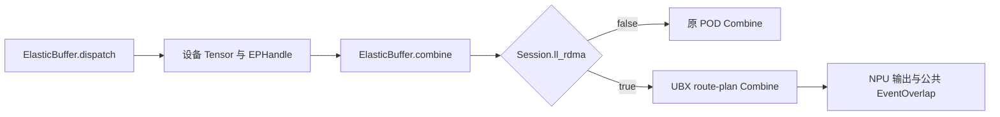

<!-- Copyright (c) 2026, Lu Lu -->

# UBX RDMA V2 Combine

UBX Combine 与 RDMA Dispatch 使用同一套 `deep_ep.ElasticBuffer`、`EPHandle`、
`deep_ep._C`、`libdeepep_kernels.so` 和 SHMEM Runtime。构造 Buffer **之前**设置
`DEEPEP_LL_BACKEND=rdma`，与现有 Dispatch 的选择方式一致；使用后不要修改该配置。
机内走 MTE，跨机走 HNS_1825 RDMA。`mte` 模式继续使用原 POD Combine，其他机型的
Direct 后端不变。不提供第二套 `ubx.Session`、CPU 字节串 `Combine` 或 `run()` 接口。

所有算子使用仓库锁定的 SHMEM `release/v1.8.0`。RDMA 参与规模为每机 16 rank，
EP16/32/64/128/256；每 rank 一个 NPU，rank 按物理主机连续排列。它不是
`machine_type="ubx"`；必要时与 RDMA Dispatch 一样显式选择 `machine_type="mesh_clos"`。

## 导入与调用

```python
from deep_ep import ElasticBuffer, EPHandle, EventHandle, EventOverlap

# 各 rank 预先绑定 NPU，并初始化相同的 EP group / bootstrap endpoint。
# 对 HCCL group，先完成一次 all_reduce 和 NPU synchronize，再构造 Buffer。
buffer = ElasticBuffer(
    group=ep_group,
    num_bytes=8 << 30,
    num_max_tokens_per_rank=256,
    hidden=0,
    num_topk=0,
    explicitly_destroy=True,
    machine_type="mesh_clos",
)
recv_x, _, _, handle, dispatch_event = buffer.dispatch(
    x,
    topk_idx=topk_idx,             # int64 [B,K]
    topk_weights=topk_weights,     # FP32 [B,K]
    num_experts=num_experts,
    num_max_tokens_per_rank=256,
    do_expand=True,
    do_cpu_sync=True,
)
# 模型负责专家计算，保持 recv_x 的行顺序；不要提前乘路由权重。
expert_output = experts_forward(recv_x, handle)
out, out_weights, event = buffer.combine(expert_output, handle)
# 默认返回前已向调用方当前流建立依赖，后续同流操作可直接消费 out。
assert out_weights is None and event.event is None
# 所有 rank 完成使用后集体销毁；再销毁调用方持有的进程组。
buffer.destroy()
```

`experts_forward` 是调用方的模型函数，不是库提供的 API。LL 的公开专家计数当前为空；
模型须知道自身分组/有效行，不能把容量布局尾部当成有效 token。默认 Dispatch 的流语义和
限制保持原样，见 [Elastic 接口](elastic.md)。`EPHandle` 是不透明对象，不能手工构造、
改内部 Tensor、跨 Buffer 复用或把 POD/其他后端 handle 传入此路径。

## `ElasticBuffer.combine`

公共参数顺序、名称、默认值和三元返回值沿用 V2，未新增 UBX 参数：

```python
out, out_weights, event = buffer.combine(
    x, handle, topk_weights=None, bias=None,
    num_sms=0, num_qps=0, previous_event=None,
    previous_event_before_epilogue=None,
    async_with_compute_stream=False, allocate_on_comm_stream=False,
)
```

| 参数 | RDMA LL Combine 的含义与支持范围 |
| --- | --- |
| `x` | 当前 Buffer NPU 上连续、无梯度的 BF16/FP16 `[handle.num_expanded_tokens,H]`；保持 Dispatch 行顺序，输入尚未乘权。FP8 Dispatch 后也须给 BF16/FP16 专家输出。 |
| `handle` | 同一个 Buffer 成功执行 payload Dispatch 返回的 LL `EPHandle`，expanded 且无 padding；可重复 Combine。 |
| `topk_weights` | 当前仅支持 `None`。路由权重已由 Dispatch 保存在 handle，kernel 内部应用一次。V2 的独立权重回传在此 LL 实现中未支持，显式传入会报错。 |
| `bias` | `None`、一个输出形状的 Tensor，或两个 Tensor 的 tuple。每个为同设备、同 dtype、连续、无梯度的 `[B,H]`，在通信流上依次加到规约输出；完成事件覆盖加法。 |
| `num_sms` | `0` 或当前实际可用 AIV 数；0 使用 Dispatch 在 Session 中固定的核数。这里单位是 AIV，不是 AICore。 |
| `num_qps` | `0` 或上述 AIV 数，保持每物理 AIV 一个 QP，不能单独重配。跨机受 SHMEM 的 56 QP 上限约束。 |
| `previous_event` | 同设备的公共 `EventHandle`；提供时要求 `allocate_on_comm_stream=True`。否则自动捕获调用流，建立输入生产依赖。 |
| `previous_event_before_epilogue` | 同设备 `EventHandle`。当前融合 kernel 没有独立 epilogue launch，因此保守地在整个 kernel 前等待，不跳过此依赖。 |
| `async_with_compute_stream` | `False`：在调用方流建立完成依赖，返回空 EventOverlap；`True`：返回有效事件，由调用方在消费流等待。两者都不主动做 Host 完成等待。 |
| `allocate_on_comm_stream` | `False`：输出分配在调用流；`True`：分配在通信流。输入、元数据、输出和 bias 均登记实际使用流，异步返回保留所需资源。 |

返回 `(out, None, event)`，`out` 为与 `x` 同 dtype 的 NPU Tensor `[B,H]`，拥有独立框架存储。
后续调用不会把已有输出作为工作区覆盖。参数格式一致不表示实现了 V2 的全部功能；
上述 LL 特有权重约定、展开布局和 shape 范围不能套到 HT 或其他机型。

异步示例，输入生产和消费均使用公共事件：

```python
ready = buffer.capture()  # 在 expert_output 生产完成之后记录当前流
out, _, done = buffer.combine(
    expert_output, handle,
    previous_event=ready,
    allocate_on_comm_stream=True,
    async_with_compute_stream=True,
)
# 在真正要消费 out 的 NPU 流中：
done.current_stream_wait(release_handle=True)
consume(out)
```

同一 Buffer 的通信由共享通信流串行下发，各 rank 必须保持调用次序一致。不要在输入仍被
kernel 使用时原地改写；另一流生产的新输入须建立对应依赖。默认路径不增加 HCCL
all_reduce、ACL Notify 门控或性能 Event；这些只属于用例的同步/测量策略。

## route-plan 实现与 POD 隔离



Host 直接引用 Dispatch 产生的 destination、counts、weights、token type、relay 和 mask，
不经 CPU 导出/重新建表。两个 kernel 共用双 bank 状态、物理主机分组、通信参数和已注册
RDMA 暂存区；核数和 QP 由同一 Session 固定。入口位于 `csrc/ops/low_latency.cpp`，
route-plan kernel 仍在 `csrc/ubx/kernels`，以独立翻译单元编入共同设备库。

保持既有 route-plan 数据路径：前半核执行 DIRECT 返回，后半核建立并复用路由表，
优先处理已就绪的跨机 partial；末 8 核兼任 ready 通知。M4 使用 6 路输入流水，
私有 WQE 预构造后等待 payload 的 MTE3 完成再发布；M5 按有效 TopK 槽完成最终规约。
例如实际 56 AIV 时仍为 28/28、notify=48..55，保持原 L2 和数据暂存策略。
发送暂存复用及退出前执行必要的 quiet，接收端检查每个 data-with-flag 块，不能以
发送方 quiet 替代远端到达检查。本次接入不修改 Dispatch kernel 或 POD kernel。

## 构建与独立 Combine 测试

两台加载各自匹配的 CANN 和 Torch/torch_npu 环境，使用相同代码/SDK 构建。
不再有独立 UBX 扩展或 `DEEPEP_UBX_RANKS_PER_HOST` 编译选项：

```bash
git submodule update --init --recursive -- third-party/shmem
python -m pip install -r requirements-build.txt
python scripts/build_shmem.py
export DEEPEP_NPU_ARCH=Ascend950
python -m pip install . --no-build-isolation --no-deps --force-reinstall
```

已有 SDK 的更新方法和版本校验见[构建指南](build.md)。下列命令每台执行，第二台把
`NODE_RANK` 改为 1；地址、端口和输出目录须属于同一次作业，且每次使用新的输出目录。
IPv6 SHMEM endpoint 使用 `tcp://[地址]:端口`。

```bash
export NODE_RANK=0
export MASTER_ADDR="<node-0-address>"
export DEEPEP_SHMEM_ENDPOINT="tcp://<shmem-bootstrap-address>:30272"
export DEEPEP_LL_BACKEND=rdma
export ASCEND_RT_VISIBLE_DEVICES=0,1,2,3,4,5,6,7,8,9,10,11,12,13,14,15
ulimit -Sn 65536
python -m torch.distributed.run --nnodes=2 --nproc-per-node=16 \
  --node-rank="$NODE_RANK" --master-addr="$MASTER_ADDR" --master-port=30271 \
  tests/ubx/test_combine.py --output results/ubx-v2-ep32-01
```

默认 BS=32/48/64/72/256、H3584、K8、E384、BF16、M256、warmup10、采样100。
用 `--iters 50` 缩短采样。改变采样轮数不改变算子、同步或计时边界。
加 case 用 `--tokens 1 2 4 8 16 24 32 48 64 72 256`。EP64 改为 `--nnodes=4`，
四台使用 NODE_RANK=0/1/2/3，仍每机16进程，不需重编。

此入口只采集 Combine 性能：CPU 生成输入/参考值，通过真实 Dispatch 取得 handle，
先校验精度、正负输入、异步消费、输出保留及双 bank 复用，再预热和采样。
性能预热与每轮采样**默认开启本地 Notify 启动门控**：先在通信流插入
`aclrtWaitAndResetNotify`，再提交 HCCL MAX all_reduce、完成依赖和公共 Combine，
全部入队后由独立 ACL 流 `aclrtRecordNotify` 放行。这样 HCCL 不会在该 rank 的
Combine 下发前先完成，减小 Host 下发偏斜。每轮等待 NPU 完成后才复用 Notify。
门控只属于此测试，生产 Combine 不增加 Notify 或 HCCL。HCCL 先于 SHMEM 初始化，
首次精度调用也在门控外完成 tiling 上传与分配器预热。

无需新增参数即可使用门控；仅在对比时显式传 `--launch-gate none` 关闭，
回显、`summary.csv` 和 `samples.json` 都记录模式。两组须使用相同参数及不同输出目录。
门控不能消除链路/设备抖动，也不代表所有 rank 在同一硬件时刻启动。
**默认 `--timer acl-event`，不启动 profiler。** 用例仍调用公共 V2 Combine，测试侧临时
包装 native 入口，在实际 Combine 下发两侧记录 `ACL_EVENT_TIME_LINE`，完成后调用
`aclrtEventElapsedTime` 并将毫秒转换为微秒；测试结束恢复原入口。
HCCL、Dispatch、tiling 上传、输出分配和框架完成事件均不放进 Event 区间。
默认门控确保 Event/kernel/Event 都已入队才放行；显式关闭门控时，Event 可能包含
Host 下发造成的流空隙。生产模块和算子实现不加入测试 hook。

需要流水图时显式传 `--timer profiler`，单独采集 `ubx_combine_route_plan` 的 kernel
task duration。两种计时都按每轮 rank-MAX 汇总，但 Event 区间与 profiler task 边界
不同，不能直接相减当固定开销。默认 Event 测试不生成 profiler trace/CSV。

先验证默认 Combine 性能后，可在相同启动命令中加入 `--check-only`，并使用新的输出目录，
单独验证 Dispatch→Combine E2E 精度、跨流消费和重复调用。此模式不运行 profiler 或性能预热；
也可增加 `--tokens 1 2 4 8 16 24 32 48 64 72 256`、`--dtype fp16` 扩大验证范围。
这里的专家计算是确定性的缩放/偏置，不是完整 FFN；真实 FFN 验证使用下方独立入口。

每轮在全部 rank 中取最大值，再对这些值计算 mean/min/P50/max，不删样本、不截尾。
另行报告按时间顺序选取的前 50 轮均值及后 50 轮 mean/min/P50/max，保留全量统计。
默认采样 100 轮时后 50 轮即第 51–100 轮，并不是时延最小的 50 轮；不足 50 轮时
使用全部实测轮次并记录实际数量。`max_iter`、`max_rank` 和最慢 5 轮回显定位拖尾，
`block10_mean` 按时间顺序列出每 10 轮均值，末组不足 10 轮时按实际数量计算。
轮次均从预热后的第一轮开始以 1 编号，rank 从 0 编号；并列时列出最早轮次/最小 rank。
rank 0 在输出根目录额外写入 `bs-B-rank-max.json`，保存全局逐轮时延、最慢 rank、
分段统计和采样配置。数据复用 case 结束时已有的采样汇总，不在计时循环增加通信。
每个 case 完成立即追加 `summary.csv`；各 rank 的 `rank-N/bs-B/samples.json` 保存原始时延：
默认字段 `combine_event_us`，profiler 模式为 `kernel_us`。回显/文件记录 timer、门控模式和
按 rank/token/TopK 槽顺序的 int32 小端路由 SHA256，便于核对两次采集使用相同路由。
仅 profiler 模式在相同目录保留 trace/CSV；解析到的 Combine task 数必须等于采样轮数，
不会使用 HCCL 或 POD kernel 的记录补足。本次路由生成仍沿用 V2 测试的 Python 随机采样；
相同 seed 不保证与旧 prepared 用例的 C++ shuffle 产生相同路由。

端到端系统回归仍可运行 `tests/elastic/test_ep_low_latency.py`；RDMA 下额外校验 Combine
跨流依赖、bias、重复 handle 和 bank 复用，并识别新的 Combine task 名。Dispatch 测量逻辑不变。
CPU 检查覆盖公开签名、流依赖/资源保活、错误路径、元数据 ABI 和 Host tiling；这些检查
不能替代 CANN 完整编译及 EP32/64 实机的精度、完成性和性能验证。

## Dispatch → FFN → Combine 精度

`tests/ubx/test_ffn.py` 通过公共 V2 Dispatch 和 Combine 执行完整前向路径，中间在 NPU
计算每个专家独立参数的两层 FFN：`(SiLU(x @ W1 + b1) @ W2 + b2)`。
每个专家保持原始输入行序，FFN 不预乘路由权重，Combine 应只应用一次非均匀 TopK 权重。
输入、路由、路由权重和专家参数由 CPU 确定性生成；CPU 参考独立按源 token/专家求和，
不使用实际 FFN 输出或 Combine 元数据构造最终参考值。

沿用上面的环境变量和 torchrun 配置，两台执行同一入口：

```bash
python -m torch.distributed.run --nnodes=2 --nproc-per-node=16 \
  --node-rank="$NODE_RANK" --master-addr="$MASTER_ADDR" --master-port=30271 \
  tests/ubx/test_ffn.py --output results/ubx-v2-ep32-ffn-01
```

默认 BS=32/48/64/72/256、H3584、K8、E384、BF16、M256，每个 BS 跑 3 轮。
`--ffn-hidden` 默认 256，控制 FFN 中间维度；这是控制 CPU Golden 成本的精度用例配置，
可改为模型实际维度。支持 `--tokens ...`、`--dtype fp16`、`--repeat N`（N≥3）。
每轮改变输入、路由和路由权重。Dispatch 与 Combine 共用 bank 计数器，因此每次 FFN 后
连续调用两次 Combine，覆盖两个 bank，并继续检查前几轮保留输出未被覆盖。
EP64 使用四台、每台16进程，其他用法一致。此用例不采集性能，不替代 Combine 独立性能用例。

检查依次覆盖 Dispatch 有效行/专家计数、FFN 输出、最终加权 Combine 以及旧输出生命周期。
Dispatch 传输使用逐元素零容差；FFN/Combine 的 CPU Golden 使用 FP32 运算，并在每个
矩阵乘、偏置和激活边界舍入为相应 BF16/FP16，最终按 BF16 `rtol=0.02, atol=0.002`、
FP16 `rtol=0.005, atol=0.0002` 检查。输出包含跨 rank 最大绝对误差和
`max_scaled = max(abs(error)/(atol + rtol*abs(reference)))`，通过要求该值不超过 1。
未使用的容量尾部填 NaN，不能被当作有效专家输出参加规约。

当前 LL 没有公开专家计数列表，因此此测试在 Dispatch 后读取内部 `send_counts` 前缀并
对照 CPU 路由，取得真实 FFN 分段；该步骤有 Host 同步，不是生产用 grouped-FFN API。
FFN 生产流、通信流和消费流分开，通过公共 `capture()` / `previous_event` / 完成事件
建立依赖。FFN 与 Combine 之间不插入 Host 全局同步、HCCL collective 或测试 Notify。
HCCL 仅用于初始化、配置与检查结果协调；精度测试不借启动门控掩盖 FFN→Combine 依赖。

每轮全部 rank 检查成功后打印 `Dispatch/FFN/Combine/reuse=PASS`；所有轮次通过且启动器
退出码为 0 才表示该配置通过。rank 0 写入 `summary.jsonl`，各 rank 保留
`rank-N/bs-B-round-R.json`。这是前向精度与生命周期检查，不覆盖训练反向或融合 FFN 性能。

## DeepJIT 与 SuperKernel

默认仍使用 Ahead-of-Time（AOT）设备库。设置 `DEEPEP_LL_JIT=ON` 并在同一环境构建扩展后，
Dispatch 与 Combine 可以在首次启动时通过 DeepJIT 编译当前 shape/topology 的专用 kernel；
AOT 路径保持不变，可随时回退。

```bash
export DEEPEP_LL_JIT=ON
python -m pip install . --no-build-isolation --no-deps --force-reinstall
export DEEPEP_LL_JIT=ON                    # 运行时选择 JIT 后端
export DEEPEP_JIT_CACHE_DIR=$HOME/.dj      # 可选；DeepJIT 的唯一缓存变量
```

- 每个 `(B,H,K,E,world,核数,dtype,dedup)` 组合编译一次，写入 `DEEPEP_JIT_CACHE_DIR`
  （默认 `$HOME/.dj`）。缓存键还包含编译器、SHMEM 头文件内容与门铃模式身份。
- Dispatch、mesh Combine 和 UBX route-plan Combine 各生成独立 ELF；DeepJIT 加载器要求
  单 kernel 入口，因此 JIT 产物只含普通入口，不含 SK 子入口和 AOT 启动包装。
- Python 在启动前调用 `low_latency_jit_prepare_dispatch` / `low_latency_jit_prepare_combine`
  完成编译与按 ACL 上下文加载；图捕获内不再编译。`Runtime` 会校验扩展确实以
  `DEEPEP_LL_JIT=ON` 构建。
- JIT 分支把 B/H/K/E、world、实际 AIV 数、wire 格式与 dedup 判定都作为编译期常量，
  只在入口保留对 immutable 通信描述和 tiling 的兼容性检查。
- Combine 的 dedup 判定需要每 rank 容量；Python 已把 `num_max_tokens_per_rank` 传给
  原生绑定，JIT 用一个权威来源生成 spec、缓存键和设备校验。

SuperKernel 入口只存在于 AOT 设备库，同一 body 由普通 global 和 `__sk__` 子入口共享：

- 普通入口从 `AscendC::GetBlockIdx()/GetBlockNum()` 生成逻辑核上下文；
- SK 子入口从 `SkSystemArgs::SkGetBlockIdx()/SkGetNumBlocks()` 生成，并把上下文传到
  计数、发送、接收、RDMA 批处理、路由表和 Combine 的所有嵌套组件；
- 每类入口的实参结构体按普通 global 的参数顺序逐字段定义，并静态对账尺寸/偏移；
- SK 使用默认能力掩码（不 early-start、不关闭 DCCI），结束时显式
  `DestroyWithoutPipeAll()`，业务 DMA 和传输退休仍在 `Process()` 内完成。

固定地址的图捕获可使用 `deep_ep.backends.ubx.graph.LLGraph`：

```python
from deep_ep.backends.ubx.graph import LLGraph

# dispatch_step / combine_step 为已准备、无分配、固定地址的启动函数。
graph = LLGraph([dispatch_step, expert_step, combine_step], scope="ll_ep").capture()
graph.replay()
graph.reset()   # 所有 rank 在最后一次设备使用完成后调用
```

图内不编译、不分配 tiling 或回读计数；原地更新输入后连续 replay。SuperKernel 融合要求
`npugraph_ex` 的 `super_kernel_optimize` 与静态 shape，scope 仅标记候选范围。
