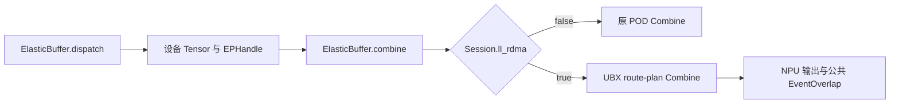

<!-- Copyright (c) 2026, Lu Lu -->

# UBX RDMA V2 Combine

UBX Combine 与 RDMA Dispatch 使用同一套 `deep_ep.ElasticBuffer`、`EPHandle`、
`deep_ep._C`、`libdeepep_kernels.so` 和 SHMEM Runtime。构造 Buffer **之前**设置
`DEEPEP_LL_BACKEND=rdma`，与现有 Dispatch 的选择方式一致；使用后不要修改该配置。
机内走 MTE，跨机走 HNS_1825 RDMA。`mte` 模式继续使用原 POD Combine，其他机型的
Direct 后端不变。不提供第二套 `ubx.Session`、CPU 字节串 `Combine` 或 `run()` 接口。

所有算子使用仓库锁定的 SHMEM `release/v1.8.0`。RDMA 参与规模为每机 16 rank，
EP16/32/64/128/256；每 rank 一个 NPU，rank 按物理主机连续排列。它不是
`machine_type="ubx"`；必要时与 RDMA Dispatch 一样显式选择 `machine_type="mesh_clos"`。

## 导入与调用

```python
from deep_ep import ElasticBuffer, EPHandle, EventHandle, EventOverlap

# 各 rank 预先绑定 NPU，并初始化相同的 EP group / bootstrap endpoint。
# 对 HCCL group，先完成一次 all_reduce 和 NPU synchronize，再构造 Buffer。
buffer = ElasticBuffer(
    group=ep_group,
    num_bytes=8 << 30,
    num_max_tokens_per_rank=256,
    hidden=0,
    num_topk=0,
    explicitly_destroy=True,
    machine_type="mesh_clos",
)
recv_x, _, _, handle, dispatch_event = buffer.dispatch(
    x,
    topk_idx=topk_idx,             # int64 [B,K]
    topk_weights=topk_weights,     # FP32 [B,K]
    num_experts=num_experts,
    num_max_tokens_per_rank=256,
    do_expand=True,
    do_cpu_sync=True,
)
# 模型负责专家计算，保持 recv_x 的行顺序；不要提前乘路由权重。
expert_output = experts_forward(recv_x, handle)
out, out_weights, event = buffer.combine(expert_output, handle)
# 默认返回前已向调用方当前流建立依赖，后续同流操作可直接消费 out。
assert out_weights is None and event.event is None
# 所有 rank 完成使用后集体销毁；再销毁调用方持有的进程组。
buffer.destroy()
```

`experts_forward` 是调用方的模型函数，不是库提供的 API。LL 的公开专家计数当前为空；
模型须知道自身分组/有效行，不能把容量布局尾部当成有效 token。默认 Dispatch 的流语义和
限制保持原样，见 [Elastic 接口](elastic.md)。`EPHandle` 是不透明对象，不能手工构造、
改内部 Tensor、跨 Buffer 复用或把 POD/其他后端 handle 传入此路径。

## `ElasticBuffer.combine`

公共参数顺序、名称、默认值和三元返回值沿用 V2，未新增 UBX 参数：

```python
out, out_weights, event = buffer.combine(
    x, handle, topk_weights=None, bias=None,
    num_sms=0, num_qps=0, previous_event=None,
    previous_event_before_epilogue=None,
    async_with_compute_stream=False, allocate_on_comm_stream=False,
)
```

| 参数 | RDMA LL Combine 的含义与支持范围 |
| --- | --- |
| `x` | 当前 Buffer NPU 上连续、无梯度的 BF16/FP16 `[handle.num_expanded_tokens,H]`；保持 Dispatch 行顺序，输入尚未乘权。FP8 Dispatch 后也须给 BF16/FP16 专家输出。 |
| `handle` | 同一个 Buffer 成功执行 payload Dispatch 返回的 LL `EPHandle`，expanded 且无 padding；可重复 Combine。 |
| `topk_weights` | 当前仅支持 `None`。路由权重已由 Dispatch 保存在 handle，kernel 内部应用一次。V2 的独立权重回传在此 LL 实现中未支持，显式传入会报错。 |
| `bias` | `None`、一个输出形状的 Tensor，或两个 Tensor 的 tuple。每个为同设备、同 dtype、连续、无梯度的 `[B,H]`，在通信流上依次加到规约输出；完成事件覆盖加法。 |
| `num_sms` | `0` 或当前实际可用 AIV 数；0 使用 Dispatch 在 Session 中固定的核数。这里单位是 AIV，不是 AICore。 |
| `num_qps` | `0` 或上述 AIV 数，保持每物理 AIV 一个 QP，不能单独重配。跨机受 SHMEM 的 56 QP 上限约束。 |
| `previous_event` | 同设备的公共 `EventHandle`；提供时要求 `allocate_on_comm_stream=True`。否则自动捕获调用流，建立输入生产依赖。 |
| `previous_event_before_epilogue` | 同设备 `EventHandle`。当前融合 kernel 没有独立 epilogue launch，因此保守地在整个 kernel 前等待，不跳过此依赖。 |
| `async_with_compute_stream` | `False`：在调用方流建立完成依赖，返回空 EventOverlap；`True`：返回有效事件，由调用方在消费流等待。两者都不主动做 Host 完成等待。 |
| `allocate_on_comm_stream` | `False`：输出分配在调用流；`True`：分配在通信流。输入、元数据、输出和 bias 均登记实际使用流，异步返回保留所需资源。 |

返回 `(out, None, event)`，`out` 为与 `x` 同 dtype 的 NPU Tensor `[B,H]`，拥有独立框架存储。
后续调用不会把已有输出作为工作区覆盖。参数格式一致不表示实现了 V2 的全部功能；
上述 LL 特有权重约定、展开布局和 shape 范围不能套到 HT 或其他机型。

异步示例，输入生产和消费均使用公共事件：

```python
ready = buffer.capture()  # 在 expert_output 生产完成之后记录当前流
out, _, done = buffer.combine(
    expert_output, handle,
    previous_event=ready,
    allocate_on_comm_stream=True,
    async_with_compute_stream=True,
)
# 在真正要消费 out 的 NPU 流中：
done.current_stream_wait(release_handle=True)
consume(out)
```

同一 Buffer 的通信由共享通信流串行下发，各 rank 必须保持调用次序一致。不要在输入仍被
kernel 使用时原地改写；另一流生产的新输入须建立对应依赖。默认路径不增加 HCCL
all_reduce、ACL Notify 门控或性能 Event；这些只属于用例的同步/测量策略。

## route-plan 实现与 POD 隔离



RoCE Dispatch 和 Combine 使用同一版本的 PUT 路由协议。普通专家行的
`destination_index[row, 1:3]` 给出本组规约卡和该卡的收件槽。槽号按本次实际 BS
编码，专家输出与路由元数据沿用 Dispatch 的行序。Host 直接传入这些设备 Tensor。

各核先将分到的普通专家行经 MTE 写入规约卡，线上每 512 B 含 480 B 数据和 32 B 到达标记。
随后前半核负责直返，优先处理跨机目标；后半核在本地收件区检查成员是否到齐，
按 Dispatch 成员顺序做局部规约并回传，最后按源 token 的 TopK 权重规约。
机内回传走 MTE，跨机回传在注册的暂存区组包后提交 RDMA WRITE。NIC 读取完成后才复用暂存槽。
单机且 Dispatch 选择直返模式时，各专家直接回传。

每个 rank 按本次实际展开行数规划 240 KiB UB，同时核算元数据、搬运 lane 和规约工作区。
整表能放下就一次处理；放不下时采用最多 2,048 行的块，必要时继续减半。集中路由可以让
同一批次只有部分 rank 分块。DeepJIT 按本机分组及 H/K/E 静态特化，BS 和实际行数仍是运行时输入。

## 构建与独立 Combine 测试

两台加载各自匹配的 CANN 和 Torch/torch_npu 环境，使用相同代码/SDK 构建。
不再有独立 UBX 扩展或 `DEEPEP_UBX_RANKS_PER_HOST` 编译选项：

```bash
git submodule update --init --recursive -- third-party/shmem third-party/deep_jit third-party/fmt
python -m pip install -r requirements-build.txt
python scripts/build_shmem.py
export DEEPEP_NPU_ARCH=Ascend950
python -m pip install . --no-build-isolation --no-deps --force-reinstall
```

已有 SDK 的更新方法和版本校验见[构建指南](build.md)。下列命令每台执行，第二台把
`NODE_RANK` 改为 1；地址、端口和输出目录须属于同一次作业，且每次使用新的输出目录。
SHMEM endpoint 使用本次作业的 IPv4 地址。

```bash
export NODE_RANK=0
export MASTER_ADDR="<node-0-address>"
export DEEPEP_SHMEM_ENDPOINT="tcp://<shmem-bootstrap-address>:30272"
export DEEPEP_LL_BACKEND=rdma
export ASCEND_RT_VISIBLE_DEVICES=0,1,2,3,4,5,6,7,8,9,10,11,12,13,14,15
ulimit -Sn 65536
python -m torch.distributed.run --nnodes=2 --nproc-per-node=16 \
  --node-rank="$NODE_RANK" --master-addr="$MASTER_ADDR" --master-port=30271 \
  tests/ubx/test_combine.py --output results/ubx-v2-ep32-01
```

默认测试 BS 1、2、4、32、48、64、256，H3584、K8、E384、BF16、容量 256。
同一组进程先完成 HCCL 预热，再初始化一次 SHMEM。每个 BS 运行真实 Dispatch，
使用独立 CPU 参考检查正负专家输出交替的四次 ACL Graph replay，覆盖双 bank 复用。
先在图外完成首次静态 kernel 编译和 tiling 上传。

性能阶段默认不刷 L2，不开启 SuperKernel。预热 5 轮后，将 100 组设备时钟等待与 Combine
录入同一张测量图。所有 rank 完成前序工作并汇合后，装入各自校准过的 deadline 表，
整图 replay 一次，轮间默认间隔 1,000 µs。用例检查各 rank 的等待记录及跨 rank 放行裕量。
默认 profiler 按顺序校验时钟与 Combine 一一对应，只取 `combine_put_jit` 的设备执行时间。
先计算每轮所有 rank 的算术平均，再对最后 50 轮取均值（默认第 51–100 轮）。
rank 0 写入 `summary.csv` 和 `bs-B-rank-mean.json`，后者保留全部逐轮均值和每个 rank
的原始样本。可用 `--warmup`、`--iters`、`--perf-tail`
调整轮数，用 `--clock-interval-us` 调整图内相邻两轮的放行间隔。

按相同 torchrun 配置分别使用以下参数，每次选择新的输出目录。

| 目的 | 用例参数 |
| --- | --- |
| 常规路由及整表路径 | `--tokens 32 48 64 --output results/combine-normal` |
| 集中路由及自动分块 | `--tokens 256 --route rank-hot --output results/combine-hot` |
| 单独验证 Dispatch → Combine 精度及图重放 | `--tokens 1 32 256 --check-only --output results/combine-check` |

以 K8、E384、BS256 为例，集中路由把全部源 token 的八个专家放到 rank 0，
EP16 和 EP32 的实际展开行数分别为 32,768 和 65,536。EP16 可验证机内 PUT 及分块；
跨机直返、局部规约后 RDMA 回传需要 EP32 或更大规模。

## Dispatch → FFN → Combine 精度

`tests/ubx/test_ffn.py` 通过公共 V2 Dispatch 和 Combine 执行完整前向路径，中间在 NPU
计算每个专家独立参数的两层 FFN：`(SiLU(x @ W1 + b1) @ W2 + b2)`。
每个专家保持原始输入行序，FFN 不预乘路由权重，Combine 应只应用一次非均匀 TopK 权重。
输入、路由、路由权重和专家参数由 CPU 确定性生成；CPU 参考独立按源 token/专家求和，
不使用实际 FFN 输出或 Combine 元数据构造最终参考值。

沿用上面的环境变量和 torchrun 配置，两台执行同一入口：

```bash
python -m torch.distributed.run --nnodes=2 --nproc-per-node=16 \
  --node-rank="$NODE_RANK" --master-addr="$MASTER_ADDR" --master-port=30271 \
  tests/ubx/test_ffn.py --output results/ubx-v2-ep32-ffn-01
```

默认 BS=32/48/64/72/256、H3584、K8、E384、BF16、M256，每个 BS 跑 3 轮。
`--ffn-hidden` 默认 256，控制 FFN 中间维度；这是控制 CPU Golden 成本的精度用例配置，
可改为模型实际维度。支持 `--tokens ...`、`--dtype fp16`、`--repeat N`（N≥3）。
每轮改变输入、路由和路由权重。Dispatch 与 Combine 共用 bank 计数器，因此每次 FFN 后
连续调用两次 Combine，覆盖两个 bank，并继续检查前几轮保留输出未被覆盖。
EP64 使用四台、每台16进程，其他用法一致。此用例不采集性能，不替代 Combine 独立性能用例。

检查依次覆盖 Dispatch 有效行/专家计数、FFN 输出、最终加权 Combine 以及旧输出生命周期。
Dispatch 传输使用逐元素零容差；FFN/Combine 的 CPU Golden 使用 FP32 运算，并在每个
矩阵乘、偏置和激活边界舍入为相应 BF16/FP16，最终按 BF16 `rtol=0.02, atol=0.002`、
FP16 `rtol=0.005, atol=0.0002` 检查。输出包含跨 rank 最大绝对误差和
`max_scaled = max(abs(error)/(atol + rtol*abs(reference)))`，通过要求该值不超过 1。
未使用的容量尾部填 NaN，不能被当作有效专家输出参加规约。

当前 LL 没有公开专家计数列表，因此此测试在 Dispatch 后读取内部 `send_counts` 前缀并
对照 CPU 路由，取得真实 FFN 分段；该步骤有 Host 同步，不是生产用 grouped-FFN API。
FFN 生产流、通信流和消费流分开，通过公共 `capture()` / `previous_event` / 完成事件
建立依赖。FFN 与 Combine 之间不插入 Host 全局同步、HCCL collective 或测试 Notify。
HCCL 仅用于初始化、配置与检查结果协调；精度测试不借启动门控掩盖 FFN→Combine 依赖。

每轮全部 rank 检查成功后打印 `Dispatch/FFN/Combine/reuse=PASS`；所有轮次通过且启动器
退出码为 0 才表示该配置通过。rank 0 写入 `summary.jsonl`，各 rank 保留
`rank-N/bs-B-round-R.json`。这是前向精度与生命周期检查，不覆盖训练反向或融合 FFN 性能。
