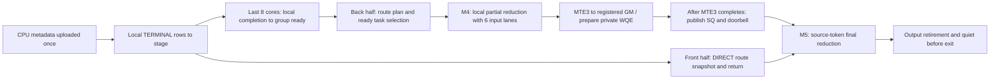

<!-- Copyright (c) 2026, Lu Lu -->

# UBX RDMA route-plan Combine

UBX 的机内通路使用 MTE，跨机回传使用 SHMEM HNS_1825 RDMA。实现位于
`csrc/ubx`，绑定为 `deep_ep.backends.ubx`，设备库为 `libdeepep_ubx_kernels.so`。
它不替换 Mesh+Clos、Mesh+PCIe 或 Global Clos 的算子，也不接入这些后端的
自动机型选择、Dispatch handle 或工作区。不同机型的 SHMEM Session 不能同时存在。
所有实现共用仓库锁定的 SHMEM `release/v1.8.0`，没有第二套运行库。

## 输入、输出与资源

独立接口接收 CPU 字节串，上传和分配发生在构造 `Combine` 时；`run(stream)`
执行准备好的单个 Combine，等待完成并返回 ACL Event 微秒数，`output()` 返回 CPU 字节串。
这是显式同步的 prepared-Combine 接口，不返回现有 ElasticBuffer 的异步 Event/handle。

| 参数 | 布局与语义 |
| --- | --- |
| expert input | `[rows, H]` BF16/FP16，按本地专家、源 rank、该专家的 token 次序展开 |
| destination | `[rows, 3]` int32：DIRECT/FIRST_HOP 为源 rank、token、TopK 槽；TERMINAL 为 stage 槽、-1、-1 |
| counts | `[E]` int32，按本地专家、源 rank 排列的累计行数 |
| types | `[rows]` int32：1 DIRECT、2 FIRST_HOP、3 TERMINAL |
| relay | `[rows, K, 2]` uint32；首项为成员数和首跳权重的 FP32 位表示，其余为 expert/occurrence 打包值及权重 |
| weights / mask | `[BS,K]` FP32、`[BS]` uint32；去重后的首跳权重为 1，被合并成员不参与最终规约 |
| output | `[BS,H]`，与输入相同 dtype |

每个源 token 的专家不重复，E 可被 EP 整除。性能用例默认 H=3584、K=8、E=384、
BF16、capacity=256、BS=32/48/64/72/256。原始路由由 CPU `mt19937(seed+rank*1009)`
和 shuffle 生成，打印路由 SHA-256 方便比较；不执行 Dispatch 或 Notify kernel。
人工表的行号、stage 槽与 relay 必须符合上述协议，不能混用其他机型的 handle。
构造器检查维度、前缀与工作区容量，调用者仍须保证跨 rank 的元数据一致。

每 rank 分配 8 GiB 对称工作区，另加 2 MiB 对齐余量和每物理 AIV 128 KiB 的
RDMA 暂存区。工作区采用两 bank 轮换；`reset()` 只能在所有 rank 都完成上轮后调用。
同一 Session 的调用必须在所有 rank 上保持相同顺序，不能跨 stream 并发执行。
所有 Combine 对象释放后，各 rank 一起调用 `Session.close()`。

## 单个 kernel 的调度



- 核数查询平台及当前可用 AIV 数，按前半发送、后半接收分工；56 核时是 28/28，
  通知由 48–55 核兼任。QP 和 GM 暂存区使用物理核编号，跨机最多受 SDK 的 56 QP 限制。
- DIRECT 路由表在 Vector 筛选期间预取；M4 在输入/输出 lane 尚未使用时借用其 UB
  建立 route plan，随后复用元数据缓存，避免逐 server 重复扫描。大表超出缓存时保留分块回退。
- ready 按核独占行进行 Vector 轮询；先执行已就绪的跨机回传任务，再执行就绪的本机任务。
  本机 partial 保持 FP32 累加，转换到输入 dtype 后回传；源端按 TopK 顺序累加有效槽。
- M4 输入环保留 6 路；M5 继承 M4 输出槽和完成事件，等待槽真正复用时再回收。
  发送/接收 UB 预算分别为 190/240 KiB，数据及控制表采用与私仓 route-plan 相同的 L2 策略。
- 私有 WQE 在 UB 预构造，payload 的 MTE3 完成后才写有效 SQ、推进 PI/敲 doorbell。
  SQ 空间不足时在 payload wait 后回退公共 put；每核每 peer 独占 QP。
- data-with-flag 每 512 B 含 480 B 数据和 32 B flag，接收端检查所有块。
  沿用 HNS_1825 的有序 packet 路径；不假定不同 QP 间有顺序。发送方 quiet 保证注册
  GM 暂存区可以复用，不替代接收方的 flag 检查。暂存批次满时及 kernel 退出前收尾。

## 构建

两台机器均激活相同 Torch/torch_npu 环境，加载各自匹配的 CANN，再执行。
UBX Combine 只需 SHMEM 子模块，不需要 CATLASS 或其他实验依赖：

```bash
git submodule update --init --recursive -- third-party/shmem
python -m pip install -r requirements-build.txt
python scripts/build_shmem.py
export DEEPEP_NPU_ARCH=Ascend950
export DEEPEP_UBX_RANKS_PER_HOST=16
python -m pip install . --no-build-isolation --no-deps --force-reinstall
```

已有旧 SDK 构建时，用 `python scripts/build_shmem.py --rebuild` 代替首次构建命令，
先停止使用该 SDK 的任务。不要复用旧 dev 的 SDK 或旧 wheel。SDK 构建会启用
HNS_1825 并记录实际 doorbell 模式；算子沿用该模式，不强制 PI-on-chip。
EP8 双机各四卡需两台都设置 `DEEPEP_UBX_RANKS_PER_HOST=4` 后重新构建；
EP32 双机各16卡和 EP64 四机各16卡共用 16 配置。完整依赖说明见[构建指南](build.md)。

## EP32 性能与正确性

两台使用同一个空闲端口、同一个 `RUN_ID`，分别设置 `NODE_RANK=0` 和 `1`。
`MASTER_ADDR` 是 Gloo/torchrun 可达地址，`SHMEM_ADDR` 是 SHMEM bootstrap 可达地址；
两者可以不同；将命令中的 `<...>` 替换为实际地址。IPv6 endpoint 写为 `tcp://[IPv6地址]:端口`。

```bash
export NODE_RANK=0
export MASTER_ADDR="<node-0-address>"
export SHMEM_ADDR="<shmem-bootstrap-address>"
export RUN_ID=ubx-ep32-01
export ASCEND_RT_VISIBLE_DEVICES=0,1,2,3,4,5,6,7,8,9,10,11,12,13,14,15
ulimit -Sn 65536
python -m torch.distributed.run --nnodes=2 --nproc-per-node=16 \
  --node-rank="$NODE_RANK" --master-addr="$MASTER_ADDR" --master-port=30271 \
  tests/ubx/test_combine.py --endpoint="tcp://${SHMEM_ADDR}:30272" \
  --output="results/${RUN_ID}"
```

EP64 改为 `--nnodes=4`，四台 `NODE_RANK=0/1/2/3`；EP8 改为
`--nproc-per-node=4`，取消 `ASCEND_RT_VISIBLE_DEVICES` 并给用例加
`--devices 12,13,14,15`，与每机四卡构建匹配。增加 case 用
`--tokens 1 2 4 8 16 24 32 48 64 72 256`。

HCCL 先完成第一次 all_reduce 和 stream synchronize，再初始化 SHMEM。
每次正确性、warmup 和采样先用本地 ACL Notify 挡住当前 NPU stream，再提交
HCCL MAX all_reduce；`work.wait()` 将依赖衔接到当前 stream。在同一 stream 排入
**start Event → Combine → end Event** 后，由独立控制 stream 释放 Notify。
这与私仓的门控顺序一致，避免 Event 已执行而主机尚未提交 Combine 的空隙。
HCCL、Notify 等待和输入上传均在计时区间之外；各卡入核时间仍可能有残余偏差。
它不是 msprof 的单 task duration，也不是整个 Python API 的墙钟耗时。

每个 case 先对正负输入和两 bank 复用校验，再 warmup 10 次、采样 100 次。
结果按每轮所有 rank 的最大 Event 耗时统计 mean/min/P50/max，不剔除异常点。
各 rank 的 `rank-N.csv` 与 rank 0 的 `summary.csv` 每个 case 刷盘。
此独立入口不导出核内 profiling/Perfetto；不要把 Event 结果当作阶段流水。

## 验证边界

CPU 检查覆盖元数据展开/重建、两机及四机归约、异步 DMA/WQE 暂存区生命周期、
SQ 回绕/满队列回退和 BF16/FP16 输出模型。它们不能替代 CANN 编译和 NPU 运行。
本次提取及 SDK 升级后的 EP8/EP32/EP64 性能、精度及其他机型回归仍须实机验证，
不把私仓旧成绩声明为这个构建的已测性能。
