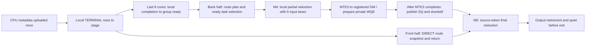

<!-- Copyright (c) 2026, Lu Lu -->

# UBX RDMA route-plan Combine

UBX 的机内通路使用 MTE，跨机回传使用 SHMEM HNS_1825 RDMA。实现位于
`csrc/ubx`，绑定为 `deep_ep.backends.ubx`，设备库为 `libdeepep_ubx_kernels.so`。
它不替换 Mesh+Clos、Mesh+PCIe 或 Global Clos 的算子，也不接入这些后端的
自动机型选择、Dispatch handle 或工作区。不同机型的 SHMEM Session 不能同时存在。
所有实现共用仓库锁定的 SHMEM `release/v1.8.0`，没有第二套运行库。

## 输入、输出与资源

独立接口接收 CPU 字节串，上传和分配发生在构造 `Combine` 时；`run(stream, synchronize)`
执行准备好的单个 Combine，等待完成并返回 ACL Event 微秒数，`output()` 返回 CPU 字节串。
这是显式同步的 prepared-Combine 接口，不返回现有 ElasticBuffer 的异步 Event/handle。

### Python 接口

入口为 `deep_ep.backends.ubx`，不在 `deep_ep` 顶层导出 `Session/Combine`。
仅导入模块不初始化 NPU；访问导出对象时按需加载原生扩展并校验安装包的 SHMEM 身份。

```python
from deep_ep.backends import ubx

session = ubx.Session(rank, world, endpoint, timeout)
case = ubx.Combine(
    session, bs, hidden, topk, experts, capacity, bf16,
    input, destination, counts, weights, types, relay, mask,
)
elapsed_us = case.run(stream, synchronize)
output_bytes = case.output()
```

两个构造器的参数均按位置传入，无默认值。`run` 也接受 `stream=` 和 `synchronize=`；
`set_input` 和 `routes` 按位置调用。这个入口没有 Dispatch 方法、自动路由建表、
`EPHandle`、异步 Event 或 autograd 接口，不能直接替换 `ElasticBuffer.combine()`。

#### Session：身份、设备与资源

```python
session = ubx.Session(rank, world, endpoint, timeout)
```

| 参数 | 类型 | 使用要求 |
| --- | --- | --- |
| `rank` | `int` | 全局 EP rank，`0 <= rank < world`，不是物理卡号；每个进程绑定一个 NPU |
| `world` | `int` | 总参与 rank 数；须为 2 的幂、不大于 256，且不小于每机参与卡数并为其整数倍；去重组必须落在单机内 |
| `endpoint` | `str` | 所有 rank 相同且可达的 SHMEM bootstrap 地址，例如 `tcp://<host>:<port>`；IPv6 为 `tcp://[<IPv6>]:<port>`；直接传参，不自动读取环境变量 |
| `timeout` | `int` | 1～3600 秒，设置 SHMEM 初始化、建链和控制操作超时；不是 `run` 的 Notify/stream 超时 |

创建前须通过 `torch.npu.set_device(...)` 设置当前 Ascend950 NPU，并先完成 HCCL
初始化、第一次 all_reduce 和流同步。调用与销毁时保持相同设备和 ACL context。
全局 rank 按主机连续排列；`ubx.ranks_per_host` 返回编译时的每机参与卡数（4 或 16），
必须与实际启动的每机进程数一致。它不表示机器上安装的总卡数，也不会选择物理卡号。

`session.cores` 是只读的实际 AIV 数，由平台和设备可用资源决定，不能由构造参数覆盖。
56 AIV 时保持 28/28 分核；跨机时还受 SDK 的每 peer QP 数上限约束。
Session 构造会初始化 SHMEM 并分配、清零工作区。机内使用 MTE，跨机增加 ROCE；
调用方的 Gloo/HCCL 进程组由调用方创建和销毁，不由 Session 接管。

#### Combine：形状与输入

```python
case = ubx.Combine(
    session, bs, hidden, topk, experts, capacity, bf16,
    input, destination, counts, weights, types, relay, mask,
)
```

| 参数 | 类型 | 使用要求 |
| --- | --- | --- |
| `session` | `ubx.Session` | 当前设备上的活跃 Session；所有参与 rank 的身份和配置一致 |
| `bs` | `int` | 每个源 rank 的实际 token 数 B，须为正数且不超过 `capacity` |
| `hidden` | `int` | H，专家输入与输出每行元素数；须通过 UB、packet 与工作区布局校验 |
| `topk` | `int` | K，1～32 且不大于全局专家数；每个 token 的专家索引不重复 |
| `experts` | `int` | E，全局专家数；`world <= E <= 1024` 且 E 可被 world 整除 |
| `capacity` | `int` | `numMaxTokensPerRank`；`bs <= capacity <= 65535`，不是显存分配大小；须与生成元数据时的容量一致 |
| `bf16` | `bool` | `True` 为 BF16，`False` 为 FP16；输入和输出均采用该编码，不自动转换 |
| `input` ～ `mask` | `bytes` | 七个连续、小端编码的 CPU 字节串；具体形状与含义见[数据布局](#数据布局) |

构造时分配输入、元数据和输出设备存储，上传七个字节串，并创建计时 Event。
不能直接传入 Torch Tensor、NumPy 数组或 `memoryview`；先按指定 dtype、布局编码为 `bytes`。
BF16 应保存原始 16-bit 位模式，不能把数值直接转换成 `uint16`。
构造完成后，修改原 CPU 数据不会改变已上传的数据；更换形状、路由或权重需重新构造 Combine。

独立测试脚本接受 BS 参数 1～256，默认只跑 32/48/64/72/256；FP16 需自行构造匹配输入，
现有 CPU fixture 和性能脚本生成 BF16。上述参数检查上限不代表所有组合已经实机验证，
构造还会检查行数、UB 和对称工作区容量；每 rank 展开行数上限为 10000。

#### 执行、更新与销毁

| 方法 | 行为与返回值 |
| --- | --- |
| `case.run(stream, synchronize) -> float` | `stream` 为当前 NPU stream 的整数句柄；调用同步回调后执行一次 Combine，等待完成，返回 ACL Event 微秒数 |
| `case.set_input(input_bytes) -> None` | 同步替换 expert input；要求字节数与构造时相同，调用方保持 shape 和 dtype 一致，元数据不变 |
| `case.output() -> bytes` | `run` 完成后将 `[BS,H]` 结果复制到 CPU，编码为构造时的 BF16/FP16；未执行 `run` 的结果无效 |
| `session.reset() -> None` | 等待本设备完成并清零工作区；所有 rank 必须先完成上轮调用，并协调后一起执行；不是跨 rank barrier |
| `session.close() -> None` | 显式释放工作区并结束 SHMEM；先释放所有 Combine 对象，再由所有 rank 协调调用；重复 close 不再次释放 |

`synchronize` 是无参数回调，在本地 Notify 已挡住计算流之后调用。它应提交 HCCL
all_reduce 和该流的完成依赖，并返回与 `stream` 相同的整数句柄。HCCL group 必须包含
相同 EP 成员，每 rank 的 token 为同 dtype/shape 的 NPU Tensor，并在回调期间保持存活。
示例（`torch`、`dist`、HCCL group 和 NPU token 已预先初始化）：

```python
def synchronize():
    work = dist.all_reduce(token, op=dist.ReduceOp.MAX, group=hccl, async_op=True)
    work.wait()
    return torch.npu.current_stream().npu_stream

stream = torch.npu.current_stream().npu_stream
elapsed_us = case.run(stream, synchronize)
```

传入回调本身，不要先执行 `synchronize()` 再把结果传入。回调中不能调用
`torch.npu.synchronize()` 等等待被挡住的流执行完毕的操作；Notify 在回调返回、
计时 Event 和 Combine 全部入队之后才释放。`run` 返回本 rank 的 Event 时间，不自动做
跨 rank MAX；HCCL、Notify 等待、输入上传和 `output()` 回读均不包含在该值中。

正常迭代复用同一 Combine，无需每次 reset；切换不同元数据/shape 前按测试流程协调 reset。
同一 Session 不支持跨 stream 并发执行。Session 关闭前显式释放所有 Combine 对象，
再由全体 rank 调用 close，最后销毁 HCCL/Gloo 进程组；不依赖 Python GC 自动 finalize。

构造参数或当前设备不合法会抛出异常，但本地校验不能验证所有跨 rank 元数据。
Notify 挡流后若回调抛错、返回不同 stream、提交或等待失败，当前实现会打印
`UBX launch gate failed` 并终止该 worker，避免悬挂流继续使用已释放资源；
Notify/stream 等待使用固定 180 秒超时。调用方应终止并重启整个作业，不能捕获后继续调用。

#### CPU 测试路由

```python
route_bytes = ubx.routes(world, bs, topk, experts, seed)
```

五个参数均为整数、按位置传入且无默认值。生成器接受 `1 <= world <= 256`、
`1 <= bs <= 256`、`1 <= topk <= min(experts, 32)`、`experts <= 1024` 和 uint32 范围的 seed。
返回 `[world,BS,K]` 的 int32 专家索引字节串；相同参数得到相同路由。
这只是 CPU 测试路由，不能直接作为 Combine 元数据，也不是设备 Dispatch。
`tests/ubx/fixture.py` 的 `make_fixture()` 根据这些路由构造测试用的七个字节串和 CPU 参考值，
该辅助模块不随 wheel 提供为公共接口。

### 数据布局

记 B=BS、H=hidden、K=topk、E=experts、P=world、L=E/P，R 为本 rank 的展开输入行数。
所有数组按行连续存储；`weights/mask` 描述本 rank 作为源卡的 token，其他五个数组
描述本 rank 持有的专家输出。空接收 rank 可以使用 R=0，仍须参与调用并产生自己的 `[B,H]` 输出。
P≤16 时每连续 4 rank 为一个去重组，P>16 时每连续 16 rank 为一组；组内不能跨物理主机。

| 参数 | Shape / dtype | 字节数 | 含义 |
| --- | --- | --- | --- |
| `input` | `[R,H]` BF16/FP16 | `R*H*2` | 未乘路由权重的专家输出，按本地专家、源 rank、该专家的 token 次序展开 |
| `destination` | `[R,3]` int32 | `R*12` | DIRECT/FIRST_HOP 为 `(source_rank, token_index, topk_slot)`；TERMINAL 为 `(stage_slot, -1, -1)` |
| `counts` | `[E]` int32 | `E*4` | 按 `local_expert*P + source_rank` 排列的累计结束行号；非负且单调不减，最后一项为 R |
| `weights` | `[B,K]` FP32 | `B*K*4` | 源端最终累加权重；DIRECT 保留原权重，已在机内加权规约的 FIRST_HOP 设为 1 |
| `types` | `[R]` int32 | `R*4` | 1=DIRECT（直接回传）、2=FIRST_HOP（机内规约后回传）、3=TERMINAL（提供给 FIRST_HOP 的机内贡献） |
| `relay` | `[R,K,2]` uint32 | `R*K*8` | FIRST_HOP 的参与成员与权重，编码见下文；其他行填 0 |
| `mask` | `[B]` uint32 | `B*4` | bit k 表示最终输出需等待并累加的 TopK 槽；每个 token 至少一个有效位，K 以外的位为 0 |
| `output()` 返回值 | `[B,H]` BF16/FP16 | `B*H*2` | 与输入相同 dtype 的 CPU 字节串 |

FIRST_HOP 的 `relay[row,0]` 为 `(n, first_weight_bits)`，n 是**除首跳自身之外**的
成员数，`1 <= n < K`。后续 `relay[row,j]`（j=1..n）为
`(expert_id | (occurrence << 16), weight_bits)`，其余槽填 0。权重使用 FP32 的原始位模式，
不是转换后的整数；`occurrence` 是该源 rank 发往该专家的 token 出现序号，从 0 开始。
首跳和这些成员必须在同一个机内去重组内。

对于 TERMINAL，令 `target=expert_id//L`、`local_expert=expert_id%L`，其 stage 槽为
`(((source_rank + target) % P) * L + local_expert) * B + occurrence`。
所有表的行、槽位和计数必须对应同一份路由。已合并成员的源端 mask 位清零，仅保留首跳；
本机规约已经应用 `relay` 中每个成员的权重，源端不能再次乘原首跳权重。
本接口与原有 HT 的模型侧乘权约定不同，不要将已经乘权的专家输出再次传入上述加权表。

当前去重开关为 `P > 16 or capacity > 32`。关闭时全部采用 DIRECT，源端使用全部 K 槽；
开启时按本接口协议生成 roles、relay 和 mask。最完整的 CPU 构造示例见
[`make_fixture()`](../tests/ubx/fixture.py)，其中还包含 EP32/64 首跳选择与参考结果生成。

每个源 token 的专家不重复，E 可被 EP 整除。性能用例默认 H=3584、K=8、E=384、
BF16、capacity=256、BS=32/48/64/72/256。原始路由由 CPU `mt19937(seed+rank*1009)`
和 shuffle 生成，打印路由 SHA-256 方便比较；不执行 Dispatch 或 Notify kernel。
人工表的行号、stage 槽与 relay 必须符合上述协议，不能混用其他机型的 handle。
构造器检查维度、前缀与工作区容量，调用者仍须保证跨 rank 的元数据一致。

每 rank 分配 8 GiB 对称工作区，另加 2 MiB 对齐余量和每物理 AIV 128 KiB 的
RDMA 暂存区。工作区采用两 bank 轮换；`reset()` 只能在所有 rank 都完成上轮后调用。
同一 Session 的调用必须在所有 rank 上保持相同顺序，不能跨 stream 并发执行。
所有 Combine 对象释放后，各 rank 一起调用 `Session.close()`。

### 单次调用示例

下面展示 BF16 输入准备、初始化顺序、同步回调、执行和清理的完整调用。
从源码根目录运行，以便读取 CPU fixture；它是测试数据生成器，业务接入应按上述协议
提供自己的七个输入字节串。环境由 torchrun 设置，当前可见卡的逻辑编号为 `LOCAL_RANK`；
运行前为所有 rank 设置相同的 `DEEPEP_SHMEM_ENDPOINT`。
使用四张指定物理卡的启动方式见后面的[运行说明](#ep32-性能与正确性)。

```python
import os
import runpy
from array import array

import torch
import torch.distributed as dist
import torch_npu  # Registers torch.npu.

from deep_ep.backends import ubx

rank = int(os.environ["RANK"])
world = int(os.environ["WORLD_SIZE"])
local = int(os.environ["LOCAL_RANK"])
local_world = int(os.environ["LOCAL_WORLD_SIZE"])
torch.npu.set_device(local)
dist.init_process_group("gloo")
hccl = dist.new_group(backend="hccl")
token = torch.ones(1, dtype=torch.float32, device="npu")


def synchronize():
    work = dist.all_reduce(token, op=dist.ReduceOp.MAX, group=hccl, async_op=True)
    work.wait()
    return torch.npu.current_stream().npu_stream


synchronize()
torch.npu.synchronize()  # Complete the first HCCL operation before SHMEM.
stream = torch.npu.current_stream().npu_stream
assert local_world == ubx.ranks_per_host
session = ubx.Session(rank, world, os.environ["DEEPEP_SHMEM_ENDPOINT"], 180)

bs, hidden, topk, experts, capacity = 32, 3584, 8, 384, 256
routes = array("i")
routes.frombytes(ubx.routes(world, bs, topk, experts, 0))
make_fixture = runpy.run_path("tests/ubx/fixture.py")["make_fixture"]
data = make_fixture(routes, world, rank, bs, hidden, topk, experts, local_world, capacity)
case = ubx.Combine(
    session, bs, hidden, topk, experts, capacity, True,
    data["input"], data["destination"], data["counts"], data["weights"],
    data["types"], data["relay"], data["mask"],
)
elapsed_us = case.run(stream, synchronize)
output_bytes = case.output()
output = torch.frombuffer(bytearray(output_bytes), dtype=torch.bfloat16).reshape(bs, hidden)
print(f"rank={rank} local_combine_event_us={elapsed_us:.3f} output_shape={tuple(output.shape)}")

del case
dist.barrier()
session.close()
dist.destroy_process_group(hccl)
dist.destroy_process_group()
```

此示例只执行一次，不用于性能结论。包含重复正确性检查、warmup、采样和逐轮 rank-MAX
统计的可执行入口是 [`tests/ubx/test_combine.py`](../tests/ubx/test_combine.py)，运行命令见下文。
生产调用保留 Combine 对象即可重复 `run(stream, synchronize)`；更新专家结果使用
`case.set_input(new_input_bytes)`，其上传发生在 Event 计时之前。

## 单个 kernel 的调度



- 核数查询平台及当前可用 AIV 数，按前半发送、后半接收分工；56 核时是 28/28，
  通知由 48–55 核兼任。QP 和 GM 暂存区使用物理核编号，跨机最多受 SDK 的 56 QP 限制。
- DIRECT 路由表在 Vector 筛选期间预取；M4 在输入/输出 lane 尚未使用时借用其 UB
  建立 route plan，随后复用元数据缓存，避免逐 server 重复扫描。大表超出缓存时保留分块回退。
- ready 按核独占行进行 Vector 轮询；先执行已就绪的跨机回传任务，再执行就绪的本机任务。
  本机 partial 保持 FP32 累加，转换到输入 dtype 后回传；源端按 TopK 顺序累加有效槽。
- M4 输入环保留 6 路；M5 继承 M4 输出槽和完成事件，等待槽真正复用时再回收。
  发送/接收 UB 预算分别为 190/240 KiB，数据及控制表采用与私仓 route-plan 相同的 L2 策略。
- 私有 WQE 在 UB 预构造，payload 的 MTE3 完成后才写有效 SQ、推进 PI/敲 doorbell。
  SQ 空间不足时在 payload wait 后回退公共 put；每核每 peer 独占 QP。
- data-with-flag 每 512 B 含 480 B 数据和 32 B flag，接收端检查所有块。
  沿用 HNS_1825 的有序 packet 路径；不假定不同 QP 间有顺序。发送方 quiet 保证注册
  GM 暂存区可以复用，不替代接收方的 flag 检查。暂存批次满时及 kernel 退出前收尾。

## 构建

两台机器均激活相同 Torch/torch_npu 环境，加载各自匹配的 CANN，再执行。
UBX Combine 只需 SHMEM 子模块，不需要 CATLASS 或其他实验依赖：

```bash
git submodule update --init --recursive -- third-party/shmem
python -m pip install -r requirements-build.txt
python scripts/build_shmem.py
export DEEPEP_NPU_ARCH=Ascend950
export DEEPEP_UBX_RANKS_PER_HOST=16
python -m pip install . --no-build-isolation --no-deps --force-reinstall
```

已有旧 SDK 构建时，用 `python scripts/build_shmem.py --rebuild` 代替首次构建命令，
先停止使用该 SDK 的任务。不要复用旧 dev 的 SDK 或旧 wheel。SDK 构建会启用
HNS_1825 并记录实际 doorbell 模式；算子沿用该模式，不强制 PI-on-chip。
EP8 双机各四卡需两台都设置 `DEEPEP_UBX_RANKS_PER_HOST=4` 后重新构建；
EP32 双机各16卡和 EP64 四机各16卡共用 16 配置。完整依赖说明见[构建指南](build.md)。

## EP32 性能与正确性

两台使用同一个空闲端口、同一个 `RUN_ID`，分别设置 `NODE_RANK=0` 和 `1`。
`MASTER_ADDR` 是 Gloo/torchrun 可达地址，`SHMEM_ADDR` 是 SHMEM bootstrap 可达地址；
两者可以不同；将命令中的 `<...>` 替换为实际地址。IPv6 endpoint 写为 `tcp://[IPv6地址]:端口`。

```bash
export NODE_RANK=0
export MASTER_ADDR="<node-0-address>"
export SHMEM_ADDR="<shmem-bootstrap-address>"
export RUN_ID=ubx-ep32-01
export ASCEND_RT_VISIBLE_DEVICES=0,1,2,3,4,5,6,7,8,9,10,11,12,13,14,15
ulimit -Sn 65536
python -m torch.distributed.run --nnodes=2 --nproc-per-node=16 \
  --node-rank="$NODE_RANK" --master-addr="$MASTER_ADDR" --master-port=30271 \
  tests/ubx/test_combine.py --endpoint="tcp://${SHMEM_ADDR}:30272" \
  --output="results/${RUN_ID}"
```

EP64 改为 `--nnodes=4`，四台 `NODE_RANK=0/1/2/3`；EP8 改为
`--nproc-per-node=4`，取消 `ASCEND_RT_VISIBLE_DEVICES` 并给用例加
`--devices 12,13,14,15`，与每机四卡构建匹配。增加 case 用
`--tokens 1 2 4 8 16 24 32 48 64 72 256`。

HCCL 先完成第一次 all_reduce 和 stream synchronize，再初始化 SHMEM。
每次正确性、warmup 和采样先用本地 ACL Notify 挡住当前 NPU stream，再提交
HCCL MAX all_reduce；`work.wait()` 将依赖衔接到当前 stream。在同一 stream 排入
**start Event → Combine → end Event** 后，由独立控制 stream 释放 Notify。
这与私仓的门控顺序一致，避免 Event 已执行而主机尚未提交 Combine 的空隙。
HCCL、Notify 等待和输入上传均在计时区间之外；各卡入核时间仍可能有残余偏差。
它不是 msprof 的单 task duration，也不是整个 Python API 的墙钟耗时。

每个 case 先对正负输入和两 bank 复用校验，再 warmup 10 次、采样 100 次。
结果按每轮所有 rank 的最大 Event 耗时统计 mean/min/P50/max，不剔除异常点。
各 rank 的 `rank-N.csv` 与 rank 0 的 `summary.csv` 每个 case 刷盘。
此独立入口不导出核内 profiling/Perfetto；不要把 Event 结果当作阶段流水。

## 验证边界

CPU 检查覆盖元数据展开/重建、两机及四机归约、异步 DMA/WQE 暂存区生命周期、
SQ 回绕/满队列回退和 BF16/FP16 输出模型。它们不能替代 CANN 编译和 NPU 运行。
本次提取及 SDK 升级后的 EP8/EP32/EP64 性能、精度及其他机型回归仍须实机验证，
不把私仓旧成绩声明为这个构建的已测性能。
