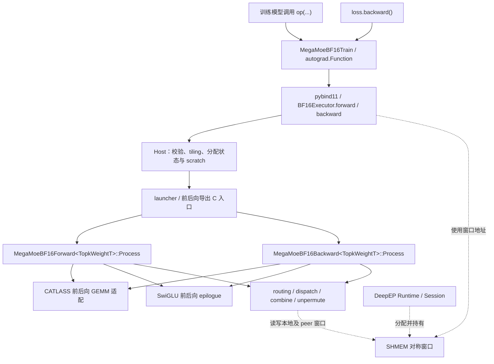
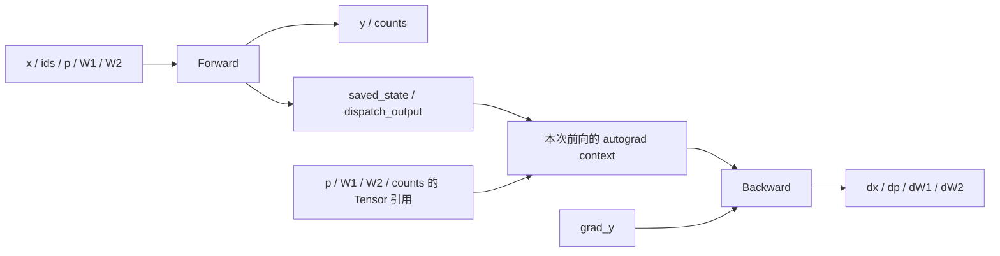
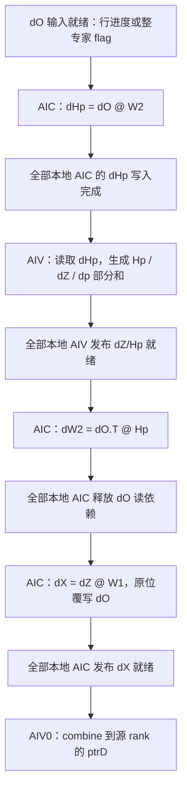

# MegaMoE BF16 训练前后向设计

> 更新日期：2026-11-04。本文描述当前实现，覆盖 Python autograd、Host 调度、BF16 forward/backward kernel 及前后向状态衔接；设备验收范围以对应构建的实际测试记录为准。

## 1. 概述

### 1.1 基本信息

| 项目 | 当前实现 |
| --- | --- |
| 对外入口 | `MegaMoeBF16Train`，通过 `loss.backward()` 进入反向 |
| 计算内容 | EP MoE 的路由、两层专家计算与结果合并，以及输入、路由权重和两层专家权重的梯度 |
| 目标平台 | Ascend 950；设备编译参数为 `--npu-arch=dav-3510`，CATLASS 使用 `Arch::Ascend950` |
| 数据类型 | x、专家矩阵、y、dx/dw1/dw2 为 BF16；p/dp 为 BF16 或 FP32，dp 跟随输入 p；路由元数据 int32，dp 乘积与归约 FP32 |
| 计算组织 | 前向、反向各提交一个融合 kernel，逻辑 block 均配对 1 个 AIC 和 2 个 AIV |
| 通信方式 | 内核通过 SHMEM peer 窗口搬运路由数据；Runtime/Session 管理窗口生命周期 |

本文统一使用 `M` 表示每个源 rank 的 token 数，`K` 表示 hidden 维，`F` 表示专家中间维，`N=2F`，`T` 表示 topk，`E` 表示本地专家数，`R=max_recv_tokens` 表示本 rank 的总接收行容量。`Me` 是某个本地专家的有效路由行数。

### 1.2 功能与接口

```python
op = MegaMoeBF16Train(ep_group, local_mem_size, timeout=120, debug_collectives=False)
y, counts = op(
    x, topk_ids, topk_weights, w1, w2, max_recv_tokens,
    swiglu_limit=0.0, save_gmm1_output="bf16",
)
loss = (y * grad_y).sum()
loss.backward()
op.close()
```

前向输入为 BF16 `x=[M,K]`、BF16 或 FP32 `topk_weights=[M,T]`、int32 `topk_ids=[M,T]` 和 BF16 本地专家权重；公开返回 BF16 `y=[M,K]`、int32 `counts=[E]`。同次调用各 EP rank 的 p dtype 必须一致，FP32 p 在搬运和参与激活计算前不降为 BF16。

反向不是独立公开的 Python 算子入口。自定义 autograd 接收 `grad_y`，使用对应前向保存的状态调用 C++，返回以下四类梯度：

| 梯度 | canonical 形状 | 类型 | 所在 rank |
| --- | --- | --- | --- |
| `dx` | `[M,K]` | BF16 | 原始 token 所在源 rank |
| `dtopk_weights` | `[M,T]` | 与输入 p 同类型 | 原始路由所在源 rank |
| `dw1` | `[E,N,K]` | BF16 | 专家所在 rank |
| `dw2` | `[E,K,F]` | BF16 | 专家所在 rank |

也支持 `w1=[E,K,N]`、`w2=[E,F,K]` 的 legacy 布局，权重梯度保持输入布局。`topk_ids` 和 `counts` 不参与求导；实现一次计算完整四类梯度，不按各输入的 `requires_grad` 切换 kernel。Function 使用 `once_differentiable`，不支持二阶求导。

所有 Tensor 需连续且位于构造模块时选定的同一 NPU；前后向在构造流上串行提交，各 rank 保持相同的集体操作顺序。完整公开契约见[用户指南](BF16_USER_GUIDE_ZH.md)。

`debug_collectives=False` 为默认设置，保留本地 dtype、流和生命周期检查，不在每次前后向增加 dtype 集体操作。初始化协调并检查各 rank 的 debug 设置；开启后，每次原生调用前额外集体检查 p dtype 和前向/反向阶段。此检查不校验图身份或完整调用顺序，框架仍负责各 rank 对应调用的一致性。

### 1.3 数学关系与舍入边界

对一个专家的 packed 输入，先忽略 clipping 和浮点舍入：

```text
Z = Xpacked @ W1.T                 # [Me,N]，拆成 gate / up
H = silu(gate) * up                # [Me,F]
Hp = p * H                         # 每条路由一个权重 p
O = Hp @ W2.T                      # [Me,K]，随后 combine 到源 rank

dHp = dO @ W2
dH = p * dHp
dGate = dH * silu'(gate) * up
dUp = dH * silu(gate)
dZ = concat(dGate, dUp)
dXpacked = dZ @ W1
dW1 = dZ.T @ Xpacked
dW2 = dO.T @ Hp
dp = sum_F(dHp * H)
```

源 rank 最后把每个 token 的 `T` 条 `dXpacked` 按 slot 顺序在 FP32 中累加，再一次性舍入为 BF16 的 `dx`；前向的 `y` 同样按 slot 顺序 FP32 累加后单次舍入。每条路由的 `dp` 恢复为 `[M,T]` 的 `dtopk_weights`。权重梯度保留在专家 rank，本模块不执行额外的数据并行梯度归约。

实际数值语义只有少量 BF16 边界。令 `Rbf16` 表示就近偶数舍入到 BF16：

```text
p32  = FP32(p)                    # BF16 无损提升，FP32 保持原值
H    = silu_FP32(gate) * up        # FP32，不插入 BF16 舍入
Hp   = Rbf16(H * p32)              # 前向唯一舍入的激活量
dHp                                # GMM 输出，BF16
dH   = FP32(dHp) * p32             # FP32，直接进入激活导数，不再舍入
dGate, dUp = Rbf16(...)            # BF16，作为 dW1 GEMM 输入
dp32 = sum_FP32(FP32(dHp) * H)     # 乘积、tile 部分和与最终归约均为 FP32
dp   = Rbf16(dp32) if p为BF16 else dp32  # 按输入 p 类型写回，不合并不同 TopK slot
```

SiLU 和导数内部保留 FP32 中间量，不能提前把 SiLU 单独舍入为 BF16。正的有限 `swiglu_limit=L` 对 Gate 做上界裁剪、对 Up 做双侧裁剪。令 `raw_g/raw_u` 是裁剪前的 BF16 值，`g/u` 为裁剪后的 FP32 值，反向边界为：

```text
g = min(FP32(raw_g), L)             # clipping 关闭时使用原值
u = clamp(FP32(raw_u), -L, L)
gate_mask = (raw_g <= L)
up_mask   = (-L <= raw_u <= L)      # clipping 关闭时两个 mask 均为 1
s = 1 / (1 + exp(-g))              # FP32，使用准确 Div
silu = g / (1 + exp(-g))           # FP32，不先舍入 SiLU
dUp   = Rbf16(FP32(dH) * silu * up_mask)
dGate = Rbf16((FP32(dH) * u) * (s * (1 + g * (1 - s))) * gate_mask)
```

裁剪边界点传递梯度，超出范围的相应梯度为零；导数中的 `dH*u` 不插入额外 BF16 舍入。MXFP8 模式使用解码后的 Gate/Up，并用前向保存的三个位平面恢复原始裁剪判定；压缩具有独立误差，重建的 H 不保证与未压缩前向逐位一致。

梯度按 FP32 子图计算，在上述 BF16 张量边界收口；FP32 p 的 dp 不再插入末端 BF16 Cast。浮点 Cast 使用恒等梯度约定。它不是离散 BF16 舍入函数的严格数学导数，不能直接用跨越 BF16 台阶的微小有限差分验证整个算子。内部平滑子图、裁剪掩码和 BF16 边界需分别核对；现有回归见 [test_reference_contract.py](../tests/bf16/test_reference_contract.py)，设备验收入口见第 6 节。

## 2. 架构设计

### 2.1 模块职责与调用关系



实线表示调用关系，虚线表示资源关系。SHMEM 窗口是通信数据和同步槽的存储区域，不是计算链末尾的返回步骤。Session 负责释放窗口，BF16Executor 和设备内核只使用其地址。

| 层次 | 主要职责 | 阅读入口 |
| --- | --- | --- |
| Python | 保留前向状态与 p dtype、匹配反向、检查流与生命周期；可选逐次 dtype/阶段集体诊断 | [bf16.py](../python/deep_ep_experimental/megamoe_train/bf16.py) |
| C++ 接口 | 薄绑定、命名结果结构、执行器入口 | [bindings.cpp](../csrc/bindings.cpp)、[training.hpp](../csrc/bf16/training.hpp) |
| Host | Tensor 契约、保存模式、资源与容量检查、状态及 scratch 分配 | [training.cpp](../csrc/bf16/training.cpp)、[tiling.cpp](../csrc/bf16/tiling.cpp) |
| launcher / 设备入口 | 在当前流分别提交前后向 `__mix__(1,2)` kernel | [launcher.cpp](../csrc/bf16/launcher.cpp)、[forward.cpp](../csrc/kernels/bf16/mega_moe_bf16_forward.cpp)、[backward.cpp](../csrc/kernels/bf16/mega_moe_bf16_backward.cpp) |
| Device 主控 | 前向完整路由计算流程、反向 P0～P6、专家循环与通信依赖 | [forward.hpp](../csrc/kernels/bf16/mega_moe_bf16_forward.hpp)、[backward.hpp](../csrc/kernels/bf16/mega_moe_bf16_backward.hpp) |
| GEMM / epilogue | GEMM 布局、GM/UB 交接、激活及梯度、保存激活 | `catlass/`、`epilogue/` 中配对的 forward/backward 实现 |
| layout / schedule | 内存契约、地址视图、producer 就绪与任务安排 | [layout](../csrc/kernels/bf16/layout)、[schedule](../csrc/kernels/bf16/schedule) |

### 2.2 开发视图

以下列出前后向主链相关文件，路径相对 `experiments/megamoe_train/`：

```text
python/deep_ep_experimental/megamoe_train/bf16.py
csrc/
├── bindings.cpp
├── bf16/
│   ├── training.hpp / training.cpp
│   ├── tiling.hpp / tiling.cpp / tiling_impl.hpp
│   └── launcher.hpp / launcher.cpp / kernel_launch.hpp
└── kernels/bf16/
    ├── mega_moe_bf16_forward.cpp / mega_moe_bf16_forward.hpp
    ├── mega_moe_bf16_backward.cpp / mega_moe_bf16_backward.hpp
    ├── catlass/
    │   ├── mega_moe_bf16_forward_catlass_impl.hpp
    │   └── mega_moe_bf16_backward_catlass_impl.hpp
    ├── epilogue/
    │   ├── block_epilogue_swiglu_forward_bf16.hpp
    │   ├── block_epilogue_swiglu_backward_bf16.hpp
    │   └── block_saved_gate_up_mxfp8.hpp
    ├── layout/
    │   ├── mega_moe_layout.hpp
    │   ├── mega_moe_saved_meta.hpp
    │   ├── mega_moe_topk_weight_gather_layout.hpp
    │   ├── mega_moe_unpermute_layout.hpp
    │   ├── mega_moe_workspace_view.hpp
    │   └── mega_moe_context.hpp
    ├── schedule/
    │   ├── forward_prepared_phase.hpp
    │   ├── backward_dispatch_ready.hpp
    │   ├── backward_dispatch_schedule.hpp
    │   └── backward_dispatch_schedule_math.hpp
    └── routing/
        ├── moe_init_routing_v3/arch35/
        ├── mega_moe_topk_weight_gather.hpp
        ├── mega_moe_combine_send.hpp
        └── mega_moe_unpermute.hpp
```

两组 `.cpp` 是设备编译和导出入口；对应 `.hpp` 中的 `MegaMoeBF16Forward`、`MegaMoeBF16Backward` 是流水线主控。CATLASS 适配负责各类 GEMM 的执行与交接，epilogue 负责激活、梯度和可选激活保存，入口文件保持薄封装。

### 2.3 前后向状态衔接与生命周期

autograd 为每次前向保存六个 Tensor：

```text
topk_weights, w1, w2, counts, saved_state, dispatch_output
```

`saved_state` 保留路由映射、计数快照、cumsum 和可选 Gate/Up；`dispatch_output` 独立保留 packed X 与 packed TopK 权重。原始 `x/topk_ids` 不额外保存在 autograd context。`counts` 被保留并传给 Host，设备反向寻址主要依据保存的路由与累计计数表。

保存状态中保留的 1 KiB 区域仅用于固定后续布局偏移，其内容不表示诊断阶段或就绪状态；真实的反向 dispatch 行进度计数在独立控制区分配与初始化。

前向内部返回 `ForwardResult{y, counts, saved_state, dispatch_output}`；Python 只将前两项交给调用方，后两项和参数引用由 autograd 保留。对应反向返回 `BackwardResult{dx, dtopk_weights, dw1, dw2}`。



此图表示数据和状态传递。前向临时区不进入 autograd context，反向有自己的 workspace。

| 前向产生的内容 | 产生位置 / 保存位置 | 对应反向用途 |
| --- | --- | --- |
| packed→原始 route 映射 | routing / `saved_state.expandedRowIdx` | 按相同路由展开 dY |
| 原始 route→packed 映射 | routing / `saved_state.expandedRowIdxGather` | 恢复 dx 和 dTopK 的原始顺序 |
| cumsum、源 rank 段偏移 | 计数交换 / `saved_state` | 复原专家、来源 rank 和 packed 行的对应关系 |
| 完整 token 计数快照 | `SaveForwardState()` / `saved_state` | 恢复已被前向清零、可能被后续调用复用的 SHMEM 计数表 |
| packed X 和 packed p | dispatch 直接写入 `dispatch_output` | dW1、Gate/Up 重算及 SwiGLU 反向 |
| 可选 Gate/Up、scale、clip mask | GMM1 / forward epilogue / `saved_state` | saved 模式免重算并保留裁剪判定 |
| Hp 与前向就绪 flag | `forward_transient_workspace` | 只供本次前向使用；反向会重新生成 Hp |

普通训练路径的 `SaveForwardState()` 只复制可变的 SHMEM 计数表；其余持久字段已经在最终保存位置生成。不能把这个函数理解为复制所有前向中间量，也不能仅保留 SHMEM 地址代替计算图状态。

每个计算图有独立的保存状态，保留的 p Tensor 决定该次反向的 dtype；同一实例可按各 rank 一致的顺序交替使用 BF16/FP32 p，并排队不同保存模式的前向。通信窗口和执行器 context 则由同一模块复用。Host 为单次反向分配 scratch 和输出，并在当前 NPU stream 上 `recordStream`。这保护异步分配器生命周期，不代表支持并发换流。关闭模块前必须完成所需反向，或丢弃不再使用的图。

### 2.4 外部训练框架如何接入

外部框架通过 Python Module 接入，在 router/TopK 之后传入 token、路由和本地专家参数。安装、参数、权重适配、多层复用及容量规划统一见[用户指南](BF16_USER_GUIDE_ZH.md)。

实现上的边界是：一个模块绑定一个 EP 组、NPU、构造流及 Session，前后向串行共享通信窗口，每次前向保留独立的计算图状态。本文件后续章节说明该边界下的计算、地址复用与同步。

## 3. 实现方案

### 3.1 保存模式与模板选择

| 请求模式 | 解析后的模式 | Gate/Up 来源 | dHp / dX 交接 | dW2 时机 |
| --- | --- | --- | --- | --- |
| `none` | `kSaveNone=1` | P0-C 从 packed X 重算 | 配对 AIC/AIV 的 UB 路径 | P4 |
| `bf16` | `kSaveBf16=2` | 前向保存的 BF16 数据 | GM 路径 | P2 内先算 dW2，再覆写 dO |
| `mxfp8` | `kSaveMxFp8=3` | 保存的压缩数据、scale 及可选 clipping mask | GM 路径 | 同上 |
| `auto` | `kSaveAuto=0` 先解析 | 关闭 clipping 时选 MXFP8，否则选 BF16 | 随解析结果 | 随解析结果 |

[mega_moe_layout.hpp](../csrc/kernels/bf16/layout/mega_moe_layout.hpp) 中的 `UseGmForBackwardDataGrad(savedMode)` 要求传入已解析模式，其条件为 `savedMode != kSaveNone`。它控制反向数据梯度的 GM/UB 交接，不表示 `none` 路径完全不用 GM，也不控制前向 SwiGLU 的独立构建策略。

保存模式与 p dtype 独立：所有模式保持 BF16/FP32 p 原类型，MXFP8 仅压缩 Gate/Up，不量化 p。clipping 的数值和掩码规则也不随 p dtype 改变。

`TopkWeightT` 为 `bfloat16_t` 或 `float`，控制 p/dp 的读写与 epilogue；`TransW` 模板参数适配 canonical/legacy 权重布局；`GmOutput` 选择 GEMM 结果交接位置。没有 ACLNN TilingKey 分发，Host 直接传递 `MegaMoeTilingData` 和 `splitExperts`，设备导出入口按 `topkWeightType` 选择前后向的 typed kernel，再按保存模式与布局选择已有模板。

### 3.2 Host 与 tiling

Host 的 `ops::MegaMoeBF16Forward()` 从 x、路由和权重推导维度，`ops::MegaMoeBF16Backward()` 从 grad_y、权重及保存状态构造相容的 tiling。两者检查各自的 dtype、连续性、形状和容量要求，在当前流分配并提交执行。

Host 由 p 的实际 dtype 得到 `topkWeightType` 与 2/4 字节宽度，前后向使用同一规则规划通信窗口、`DispatchOutputLayout` 和保存状态，并按 p 类型分配 `dtopk_weights`。GEMM 的 X、专家权重和主要激活面仍是 BF16，不能因 FP32 p 将所有布局中的 2 字节统一改为 4 字节。

| 项目 | Forward | Backward |
| --- | --- | --- |
| 持久状态 | 分配 `saved_state` 和 `dispatch_output` | 读取对应前向保留的两个 Tensor |
| 临时区 | Hp、前向就绪控制、行进度及按需添加的 raw Up 平面 | dO、dZ、Hp、dp 部分和及反向控制区 |
| 初始化 | 保存状态的元数据区在 Host 清零；transient 控制在 kernel 入口重置 | 仅清零 backward workspace 控制区；有效数据行由 kernel 覆写 |
| 输出 | `y/counts`，以及交给 autograd 的状态 | 四类梯度；空专家权重梯度由设备显式清零 |
| 调度 | 保存模式、权重布局、前向 dispatch / SwiGLU 策略 | 保存模式、权重布局和 `splitExperts` |

两次调用都在当前流清理 SHMEM 控制区域，保留跨调用的同步代数区；随后对参与执行的 Tensor 进行 `recordStream`。Host 对前向 SwiGLU 是否走 GM 查询已加载的设备 SO，并按实际策略分配额外空间，避免 Host/Device 编译策略不一致。

关键参数来自 [MegaMoeTilingData](../csrc/kernels/bf16/common/mega_moe_tiling.hpp)：

| 字段 / 启动参数 | 含义 |
| --- | --- |
| `m/k/n/topK/expertPerRank/epWorldSize/rankId` | 形状与 EP 身份 |
| `maxOutputSize` | `R`，本 rank 所有本地专家共享的接收行容量 |
| `block_dim` | 平台 AIC 数；设备 `blockNum_=GetBlockNum()` |
| `blockNumPerEP` | `max(1, aic_num/world_size)`；设备成员为 `dispatchBlockNumPerEP_` |
| `dispatchRows` | Host 提议的 dispatch 搬运行数；反向设备端还会按静态 staging 容量限制 |
| `savedGateUpMode/swigluLimit/transW` | 保存、裁剪及权重布局策略 |
| `topkWeightType` | 0 为 BF16 p、1 为 FP32 p；配对 Host/Device 按此选择类型和字节布局 |
| `splitExperts` | 反向额外传入的行就绪专家前缀数量；按非空专家执行序号解释 |

数值范围限制不等于路由内容全部经过 Host 检查。调用方需保证专家 ID 合法且每 token 不重复，并保证容量充足。所有 rank 都有 M 个 token 时，`EP*M*min(E,T)` 是接收行数的保守上界。容量不足会截断，不能得到完整的前后向结果。详见[用户指南的限制与验收边界](BF16_USER_GUIDE_ZH.md#7-限制与验收边界)。

### 3.3 前向执行：routing → dispatch → GMM1 → SwiGLU → GMM2 → combine

主控入口为 `MegaMoeBF16Forward<TopkWeightT>::Process()`，按已解析保存模式与 `TransW` 进入 `ProcessSelected()`，再选择 `ProcessWithSaveMode<SaveMode,TransW,GmSwiglu>()`。

| 阶段 | 执行方 | 数据流和产物 |
| --- | --- | --- |
| 初始化与 routing | AIV | 入口跨 rank 屏障确认窗口计数已清理；按专家排序、展开 X，发布到源 rank `ptrA0`，生成两套 route 映射和本地计数 |
| 路由权重 gather | AIV | 将 p 按同一排序放入源 rank `ptrRoutedTopkWeights`；它还没有乘到 X 上 |
| 计数交换 / cumsum | AIV | 交换源 rank→目标专家的行数，建立本地 packed 前缀和与源段偏移，保存计数快照；counts 由主控在后续拷出 |
| Dispatch | 每对的 AIV1 | 从 peer 拉取 X 和 p，以同一行顺序写入独立 `dispatch_output`，发布就绪进度 |
| GMM1 / SwiGLU | AIC / AIV0 | AIC 算 Gate/Up；AIV0 按模式保存原始激活、计算 SwiGLU 并乘 p，写 Hp 到 `ptrA2` |
| GMM2 / Combine | AIC / AIV1 | AIC 算 `O=Hp@W2.T`；AIV1 经 UB tile 将结果写回源 rank 的 `ptrD` |
| Unpermute / 收尾 | AIV | 清理计数、排空 combine 并跨 rank 同步后，按 route 映射在 FP32 中依 slot 顺序累加 T 路结果为 y，最后一次舍入到 BF16；末尾屏障在最后读者退出后开放窗口复用 |

普通训练路径直接将 packed X/p 写入最终保留的 Tensor；cumsum 和 route 映射也直接落在 `saved_state`。计数表快照在计数交换后、dispatch 前生成，不能等前向收尾清零后再保存。

**p 的 source gather 与字节保真**：`TryGatherTopkWeights<TopkWeightT>()` 按元素的原始 16/32 位搬运 p，不通过 BF16 数值转换。源表按 `M*T` 条路由规划，不是专家端的接收容量 R。BF16 单窗最多 65536 元素，既有双窗路径复用一个 128 KiB 源区；FP32 每窗最多 32768 元素，同样只保留一个 128 KiB 源区，多窗逐次载入并合并对应的输出 batch。例如 131072 条 FP32 路由使用四个源窗，而不是将整表常驻 UB。

各窗先构造安全的窗口内字节偏移，再 Gather，并只选取该窗负责的结果；短尾窗只从 GM 读取有效字节。批次为最多 2048 条路由，FP32 多窗的源区、索引和两个结果 batch 合计最多 160 KiB，单窗最多 144 KiB；BF16 单窗/双窗分别为 140/152 KiB。此 TPipe 在后续 Dispatch 分配 UB 前释放，不能把源 gather 临时 UB 与后续流水的区域同时相加。具体计划和回退条件见 [gather layout](../csrc/kernels/bf16/layout/mega_moe_topk_weight_gather_layout.hpp) 与 [gather 实现](../csrc/kernels/bf16/routing/mega_moe_topk_weight_gather.hpp)。

**GMM1 到 SwiGLU 有两种交接方式**：

| 交接 | 原始 Gate/Up 的位置 | 依赖与复用 |
| --- | --- | --- |
| UB 配对路径 | AIC Fixpipe 到配对 AIV0 的 UB | AIV0 等待 tile 事件，保存激活并计算 Hp；释放事件后 AIC 才能复用 UB |
| GM 解耦路径 | `bf16` 直接写持久 Gate/Up；`none/mxfp8` 用 Hp 区暂存 raw Gate，并追加 raw Up 区 | 每专家所有本地 AIC 排空写入并发布 raw-ready；AIV0 读完整 tile 后，才可将 raw Gate 原位替换成 Hp |

`DEEPEP_BF16_SWIGLU_DECOUPLE=0/1/2` 分别表示 UB、GM、auto，设备构建默认 2。auto 在 `K<3584` 时用 GM；`K==3584` 仅 MXFP8 保存模式用 GM；更大的 K 用 UB。这是前向交接策略，与 `save_gmm1_output="auto"` 及反向 `UseGmForBackwardDataGrad()` 是三个不同的选择。

BF16 保存的是 clipping/activation 前的原始 Gate/Up；GM 路径已经写入持久平面，不再重复复制。MXFP8 则在激活计算前保存压缩值、scale 及所需的三个位平面。前向 SwiGLU 使用原始 BF16 Gate/Up，MXFP8 保存不是将前向 GEMM 改成 FP8。

**GMM2 进入条件和窗口回收**：GMM2 的 AIC 先等待配对 AIV1 释放 dispatch 的重叠 UB，再按专家等待 AIV0 的 Hp 完成计数。它不会为进入 GMM2 额外等待所有无关专家的 SwiGLU。结果经双缓冲交给 AIV1 combine；尾部事件排空和跨 rank 屏障保护 unpermute 的读取，最终屏障再保护下一次调用。

前向 `UnpermuteV2()` 有批量 helper（`TryUnpermute`）与按 hidden 分块（`UnpermuteByHiddenChunk`）两条路径，两者都按 TopK 顺序把 BF16 专家输出累加到 FP32 缓冲，再用 `CAST_RINT` 一次舍入为 BF16；反向 `UnpermuteBackward()` 同样是 FP32 累加后单次舍入。前后向归约宽度一致，不能把前向描述成“在 BF16 中累加”。

**前向状态容量**：令 `A512(x)` 为字节向上对齐到 512，`G=ceil(F/32)`，b 为 p 元素宽度（BF16=2、FP32=4 字节）：

| 区域 | 主要容量 | 生命周期 |
| --- | --- | --- |
| `dispatch_output` | `A512(2*R*K)+A512(b*R)` | packed BF16 X 与实际类型 p，保留至相应反向 |
| BF16 Gate/Up | 每个 `A512(2*R*F)` | `bf16` 保存状态 |
| MXFP8 Gate/Up 与 scales | 每个数据面 `A512(R*F)`、每个 scale 面 `A512(R*G)` | `mxfp8` 保存状态 |
| MXFP8 clip masks | 正 clipping 下额外三个 `A512(4*R*G)` 位平面 | 保留前向裁剪判定 |
| 前向 transient | `A512(2*R*F)` 的 Hp、控制 flag 和行进度；GM 且非 bf16 模式额外 `A512(2*R*F)` 的 raw Up | 仅当前前向异步调用 |

路由元数据容量还与 M、T、EP、E 有关，偏移以 `TrainingSavedStateLayout`、`DispatchOutputLayout` 和 `ForwardDispatchTileReadyLayout` 为准。原始 Gate/Hp 复用区与追加 raw Up 区必须避开已有控制 flag，不能只按两个激活面连续分配。

### 3.4 反向运行视图：P0～P6

阶段编号用于阅读 `Process()`，不表示所有核在每个阶段末都进行全局屏障；实际并行受下面的就绪协议控制。

| 阶段 | 执行方 | 主要数据流与结果 |
| --- | --- | --- |
| P0-A | 所有 AIV | 按前向路由 gather 原始 dY，发布到源 rank 的 SHMEM `ptrA0` |
| P0-B | 所有 AIV 恢复计数；每对的 AIV0 dispatch | 从各源 rank 的 `ptrA0` 拉取本地专家的 dO，写入 `ptrDO` |
| P0-C | AIC，仅 `none` | 用 packed X 和 W1 重算 Gate/Up，可与 AIV 的数据准备重叠 |
| P1 | AIC + 双 AIV | `dHp=dO@W2`；epilogue 生成 dZ、Hp 和 FP32 dp 部分和 |
| P2 | AIC + AIV0 | 算 dX，并 combine 回源 rank 的 `ptrD`；saved 路径在覆盖 dO 前先算 dW2 |
| P3 | AIC | `dW1=dZ.T@Xpacked` |
| P4 | AIC，仅 `none` | `dW2=dO.T@Hp`；saved 路径已在 P2 完成 |
| P5 | AIV | 从 `ptrD` 按原 token 与 TopK 顺序在 FP32 中累加 dX，再一次舍入为 BF16 的 `dx` |
| P6 | AIV | 在 FP32 中归约 dp 部分和，BF16 分支舍入、FP32 分支保留；按对应 2/4 字节路由回源 rank，并恢复 `[M,T]` 顺序 |

P3/P4 的 AIC 权重梯度计算与 AIV 的 P5 收尾可以重叠。P0-A 不乘 TopK 权重；权重作用在 P1 的 `dH=p*dHp` 和 Hp 重建中。

saved 路径对每个专家的关键依赖为：



此图表示同一专家的数据依赖，不是不同专家、不同 AIC/AIV 的严格时间线。

### 3.5 反向 GM 布局与 SHMEM 复用

| 区域 | 生命周期 / 所有者 | 反向用途 |
| --- | --- | --- |
| `saved_state` | 单次前向计算图 / Torch | 路由映射、cumsum、源 rank 偏移、计数快照、可选 Gate/Up 与压缩辅助信息 |
| `dispatch_output` | 单次前向计算图 / Torch | packed X、packed TopK 权重 |
| backward workspace | 单次反向异步调用 / Torch | dO、dZ、Hp、dp 部分和、可选重算 Gate/Up、同步控制区 |
| SHMEM 窗口 | 模块构造至集体 close / Session | 发布 dY、交换梯度、计数表和跨 rank 同步槽 |

[BackwardSavedStateInfo / BackwardWorkspaceInfo / PeermemInfo](../csrc/kernels/bf16/layout/mega_moe_workspace_view.hpp) 只把基址映射为地址视图，不负责申请或释放内存。

令 `A512(x)` 表示字节数向上对齐到 512，`P=ceil(F/256)`。backward workspace 的数据区为：

| 数据面 | 字节数 | 使用阶段 |
| --- | --- | --- |
| `ptrDO` | `A512(2*R*K)` | P0-B 写；P1 与 dW2 读 |
| `ptrRecomputeGate/Up` | 每个 `A512(2*R*F)`，仅 `none` 分配 | P0-C 写，P1 读 |
| `ptrGradZ` | `A512(2*R*N)` | P1 写，P2/P3 读 |
| `ptrHp` | `A512(2*R*F)` | P1 写，dW2 读；saved 模式先暂存 dHp |
| `ptrDpProducts` | `A512(4*R*P)` | P1 写，P6 归约 |
| `ptrDX` | saved 模式与 `ptrDO` 同址；none 为 nullptr | saved P2 写和 combine 读；无额外分配 |

控制区紧随数据区，包括 dispatch、dHp/dZ/dX 就绪、dO 释放、全局完成计数和按需追加的 producer 行进度。Host 的 `MegaMoeBF16BackwardWorkspaceLayout` 与设备 `BackwardWorkspaceInfo` 必须保持相同的偏移和模式判断。

有三组必须保留的复用顺序：

```text
ptrHp：AIC 写 dHp → 全 AIC 就绪 → 每 tile 的 AIV 完整读入 → 覆写为 Hp
ptrDO：dispatch 写 dO → P1/dW2 读完 → 全 AIC DOReleased → 覆写为 dX
ptrD ：各专家 combine 写 dX → P5 读完 → 跨 rank 屏障 → P6 写 dp → 屏障 → 读 dp
```

dHp/Hp 同址依赖 tile 唯一消费归属及先读后写；dO/dX 同址依赖所有本地 AIC 退出 dW2 读依赖。`ptrD` 的复用则必须等待所有源 rank 的旧读者完成，不能只用本地屏障。

### 3.6 反向 UB 与 epilogue

CATLASS 反向 tile 为 `128×256×256`。一个 `128×256` BF16 工作 tile 占 64 KiB，P1/P2 使用 UB 起始处的三个工作 tile，即 `[0,192 KiB)`。

P0 的 `StageUb()` 使用 `[BW_STAGE_BASE_BYTES, ArchTag::UB_SIZE)` 静态区域，`BW_STAGE_BASE_BYTES=3*64 KiB`。gather、计数恢复和 dispatch 环在每个 AIV 上先后复用该区域；它们不能覆盖可能同时被 AIC Fixpipe 使用的工作 tile。`InitStageLayout()` 按窗口剩余空间限制 ping 行数，saved 模式使用单行 DMA。

P0 不创建 TPipe，显式管理事件和静态 `LocalTensor`。P5、P6 分别创建局部 TPipe，排空后销毁，再进入后续复用。空专家权重清零使用有界零 tile，不对所有权重梯度做全量预清零。

Host 按 P1、P0 scratch、P5、P6、清零等阶段计算 UB 需求，并限制在 `min(设备查询容量,248 KiB)` 内；不能把所有分时区域简单相加，也不能忽略并行阶段的地址隔离。MXFP8 还需要 16 行分块解码及 scale/mask 临时区，Host 单独计入 P1 预算。

FP32 p 不改变三个 BF16 工作 tile。P6 的部分和读入区固定为 128 KiB，输出 batch 最多 1024 个 p 元素，Host 按实际 2/4 字节另计对齐后的 batch 容量；dp 的逆置换按原始 16/32 位进行，不将 FP32 结果先压成 BF16。

epilogue 的输入是 dHp、Gate/Up 和 packed p，输出是 dZ、Hp、dp 部分和。满 `128×256` tile 使用 `ComputeFusedFullTile`；尾块使用分步实现。两者遵循相同的数值边界。尾块在仅有三个工作 tile 的约束下会重新加载 Gate/Up，而不是同时常驻所有中间量。

MXFP8 的 clipping mask 保留前向裁剪判定，反向不能仅根据解码后是否越过阈值重新判断掩码。这里的 MXFP8 是保存激活格式，GEMM 仍是 BF16 计算路径。

### 3.7 前后向 dispatch 就绪与同步协议

前向默认候选形状要求 `E<=7` 且 `M*T>=E*768`，并对实际有效行数 `Me>=768` 的专家使用 M192 计算块与 Ready384 进度。静态 producer 元数据容量可用时，各非空专家独立选择；容量不足时只让首个非空专家进入细分候选，后续专家等完整就绪。元数据在 cumsum 阶段准备好，实际 X/p 的 ready 仍必须单独检查。

前向发布一次 ready 必须同时覆盖 X 和相同路由行的 p；只完成 X 的搬运就发布会让 SwiGLU 读到未就绪权重。计数交换可选 dense/compact 协议；compact 支持每 rank 不超过 8 个专家，默认在 EP 至少 512 且满足布局条件时选择。`MEGAMOE_BF16_TOKEN_COUNT_EXCHANGE=auto/dense/compact` 可覆盖选择，强制 compact 的参数不满足条件时 Host 报错。计数交换协议与行就绪粒度分别控制。

反向默认 saved 模式在 `E<=7` 时令 `splitExperts=E`，否则为 0；none 始终为 0。对前 `splitExperts` 个非空专家，还需 `Me>128` 才启用 producer 行就绪。进度按 256 行粒度发布，GEMM 的 M tile 为 128 行，二者含义不同。

`MEGAMOE_BF16_BWD_DISPATCH_SPLIT_EXPERTS=0..E/all` 可覆盖默认数量；`DEEPEP_BF16_FORCE_EXPERT_READY=ON` 优先级更高，使 Host/Device 都使用 0，且不追加行进度后缀。7 是默认策略阈值，不是进度内存的固定容量上限。该构建开关也使前向等待完整专家，Host/Device 必须一致；更改选项后完整重建并安装同一次构建的 wheel。

| 同步对象 | 生产者 → 消费者 | 保护的依赖 |
| --- | --- | --- |
| 前向 dispatch ready | AIV1 → GMM1 AIC | X/p 同一行都写完；可等行进度或整专家完成 |
| 前向 raw-ready（GM） | 全部本地 AIC → AIV0 | 原始 Gate/Up 写完，允许读取并按需原位改写 Hp |
| 前向 Hp 完成 flag | AIV0 → GMM2 AIC | 该专家 Hp 全部写完后才能读取 |
| `GMM2_UB_READY_FLAG` | 配对 AIV1 → AIC | dispatch 用完重叠 UB，允许 GMM2 Fixpipe 使用 |
| 反向整专家 dispatch flag / producer 行进度 | P0-B AIV0 → P1 AIC | dO 行写完才能被 GEMM 读取；整专家目标为 `EP*dispatchBlockNumPerEP_` |
| producer 元数据门 | 恢复元数据的 AIV → P1 AIC | 所有 AIV 恢复完成后，由 AIV0 在 expert 0 的 dHp flag cacheline 的 word 1 发布 |
| `DHpReady` | 每个本地 AIC → AIV | saved 模式全部 Fixpipe dHp 写完，才允许原位替换为 Hp |
| `DZReady` | 每个本地 AIV → AIC | saved 模式该专家的 dZ/Hp/部分和写入完成 |
| `DOReleased` | 每个本地 AIC → 所有本地 AIC | dW2 的全部 dO 读者退出，允许 dX 覆写 |
| `DXReady` | 每个本地 AIC → AIV0 | saved 模式 dX 写入完成，允许 combine |
| 配对 tile 事件 | AIC ↔ 配对 AIV | none 模式 dHp/dX 的 UB tile 交接和回收 |
| `Aiv1Ready/HDone` | 所有 AIV → AIC | P1 写入完成；none 路径进入后续数据/权重梯度前的依赖 |

这些计数包含没有分到 tile 的空闲核；不能因为某核无计算任务就省略到达信号。P1 的 `nextTargetAiv` 还必须跨专家累加，才能让单 tile 专家交替使用两个 AIV。

`SyncAll<true>()` 同步本 rank 所有 AIV，不包含 AIC。跨 rank 使用 `CrossRankSyncInWorldSize()`：AIV 分摊 peer 槽，写入新代数并轮询本地对应槽，最后进行本地 AIV 同步。peer 槽步长为 16 个 int32，即 64 字节；本地代数位于 `PeerSyncCountOffset(worldSize_)`。

跨核就绪信号使用 `AtomicAdd` 或 bypass-DCache 标量写发布，读侧用 `ReadGmByPassDCache` 轮询。空的 `while` 循环体可能就是必要的等待协议，不是可直接删除的空逻辑。跨 rank 屏障也不能替代发布前的本地 DMA/流水排空。

### 3.8 同步 API 与核验边界

| 调用形式 | 本实现中的职责 |
| --- | --- |
| `SetFlag<HardEvent::X_Y>(int32_t eventID)` / `WaitFlag<HardEvent::X_Y>(int32_t eventID)` | 同一核内 X、Y 流水的数据依赖和 ping-pong 槽回收 |
| `template <pipe_t pipe> void PipeBarrier()`，实例化时可选 `PIPE_ALL` | 等待相应核内流水的前序操作完成；不是跨核屏障 |
| `WaitForCube/NotifyCube/WaitForVector/NotifyVector` | 本项目使用的 AIC/AIV tile 交接封装 |
| `SyncAll<true>()` / `CrossRankSyncInWorldSize()` | 本地 AIV / EP 组的不同作用域同步 |

核内事件与 barrier 的概念、原型分别参考官方 [SetFlag/WaitFlag(ISASI)](https://www.hiascend.com/doc_center/source/en/CANNCommunityEdition/900/API/ascendcopapi/atlasascendc_api_07_0270.html) 和 [PipeBarrier(ISASI)](https://www.hiascend.com/doc_center/source/en/CANNCommunityEdition/900/API/ascendcopapi/atlasascendc_api_07_0271.html)。这些 CANN 9.0 参考用于解释同步职责，不构成目标 CANN 9.2 SDK 的完整 API 兼容性核验；编译与设备执行需使用匹配的实际 SDK 验证。

## 4. 并行与性能设计

| 设计选择 | 目的与代价 |
| --- | --- |
| 前向 X/p 联合就绪、GMM1 M192 / Ready384 | 可提前计算已收到的行；要求 producer/consumer 采用一致坐标与发布协议 |
| 前向 raw Gate/Hp 原位复用与 GM/UB 交接选择 | 控制 transient 显存与核间交接；需要 raw-ready 和读入后再覆写 |
| AIC GEMM 与 AIV dispatch/epilogue 并行 | 隐藏部分搬运和逐元素计算；需要明确跨核交接 |
| saved 模式 producer 行就绪 | 后续 dispatch 未结束时可开始计算已就绪输入；增加进度及调度控制 |
| none 模式 UB 直达配对 AIV | 减少 dHp/dX 的 GM 中转；需要重算 Gate/Up 和管理配对事件 |
| dHp/Hp、dO/dX 和 ptrD 分时复用 | 减少额外数据面；引入读者退出和跨 rank 生命周期约束 |
| dp 分 tile 写独立部分和、P6 最终归约 | 避免不同 AIV 直接争用同一个 dp 累加位置；增加部分和空间 |
| P3/P4 与 P5 重叠 | AIC 算权重梯度时，AIV 恢复输入梯度 |
| 空专家按需清零 | 避免全量输出 memset；需覆盖有效行数为零的权重平面 |

以上是实现采用的策略，不是本次测得的性能结论。不同保存模式、专家数、路由分布和形状下的收益需分别测量。

## 5. 正确性边界与风险

1. **路由与容量**：R 是本 rank 所有本地专家合计接收行数，不是每专家容量；静默截断不属于完整梯度计算。
2. **状态匹配**：反向必须使用对应前向的保存状态、dispatch payload、p dtype、权重、保存模式和 clipping 参数；不能混用其他 microbatch 的数据。
3. **复用顺序**：前向 raw Gate/Hp、反向 dHp/Hp 都需先完整读入再覆写；dO 全部读者退出与 ptrD 跨 rank 读者退出又是不同的依赖，不能互相替代。
4. **完整到达**：同步计数的参与范围是全部相应本地 AIC/AIV，包含空闲核；AIV 屏障不覆盖 AIC。
5. **流与生命周期**：模块只支持构造流上的串行调用；权重在所需反向完成前不能原地修改，窗口关闭后不能再反向。
6. **数值契约**：BF16 舍入位置、clipping mask、dp 归约顺序和 dX 的 FP32 累加都属于行为；不能仅凭代数等价改写。
7. **支持与验收**：代码接受的 EP 范围不等于所有拓扑都验证通过；当前框架文档限定设备验收为单节点 Ascend 950。
8. **超时范围**：构造参数 timeout 用于 Runtime 初始化和控制操作，不保证设备侧所有自旋等待都能在该时间内退出。
9. **配套安装**：BF16/FP32 p 共用公开类名、Host 扩展和设备库名，但 typed tiling/payload 是配套的内部契约；升级后安装同一次构建的完整 wheel，各 rank 一致。在目标运行镜像构建，转移 wheel 须匹配 Python/Torch ABI 与 glibc 等系统库。

## 6. 实现与验证入口

| 入口 | 核查内容 |
| --- | --- |
| [test_mega_moe.py](../tests/bf16/test_mega_moe.py) | 单入口：前向、四项梯度与 counts 的精度对照，以及由 `--skip` 选择的性能计时 |
| [npu_baseline.py](../tests/bf16/npu_baseline.py) | `fp32-boundaries-v3-topk-dtype` BigOp 与 MegaMoE 契约参考；p/dp 保持输入类型，ATK 的 NPU 基线 |
| [cpu_reference.py](../tests/bf16/cpu_reference.py) | Torch CPU FP64 真值，不插入 BF16 中间边界 |
| [atk_compare.py](../tests/bf16/atk_compare.py) / [cases.json](../tests/bf16/cases.json) | ATK 双标杆判定与 42 条清单：12 条模型、24 条 dtype、6 条 FP32 gather 边界 |
| [test_reference_contract.py](../tests/bf16/test_reference_contract.py) | CPU 回归：H/dH 边界、裁剪掩码、FP32 dp 归约与按 p 类型返回、保存状态重放，不访问设备 |
| [mxfp8_diagnostics.py](../tests/bf16/mxfp8_diagnostics.py) | 显式配置的 MXFP8 诊断，独立于 dtype 专项中的保存模式用例 |
| [bf16_lifecycle.py](../tests/integration/bf16_lifecycle.py) | 重复调用、排队前向、流约束和关闭重建 |

测试入口列出可执行的核查方式，文件存在不表示该版本已通过设备验证。设备结果需注明源码、完整 wheel、环境、shape 与路由；历史通过记录仅覆盖其对应的构建和执行范围。

## 7. 后续核验与阅读顺序

后续代码变更按影响选择验证：内存布局、保存格式或入口变化需同步重建完整 Host/Device wheel 并检查安装加载；计算或同步变化需在设备上覆盖四类梯度、保存模式、空专家、单/多 M tile、偏斜路由和连续多轮调用。性能比较使用相同输入、拓扑与构建策略，单独报告，不能由设计推断收益。

首次阅读建议按以下顺序：

1. 第 1 节确认数学与接口，第 2.3 节确认前后向状态怎样衔接。
2. `bf16.py` → `training.cpp` 的 `MegaMoeBF16Forward/Backward()`，看两次调用各自分配和保留什么。
3. 前向 `.cpp` → `.hpp` 的 `ProcessWithSaveMode()`，结合第 3.3 节追踪 X/p、Gate/Up、Hp、y 和保存状态。
4. 反向 `.cpp` → `.hpp` 的 `Init()`、`Process()`，结合第 3.4 节区分重算与 saved 路径。
5. `GMM2GradPhase()` → `GMM1GradReuseDOPhase()` → CATLASS 适配，结合第 3.5、3.7 节核对复用与同步。
6. 前后向 epilogue → unpermute，结合数值契约核对舍入边界与 dp。
